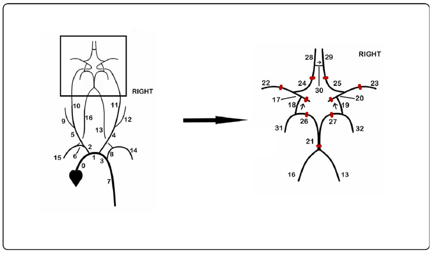
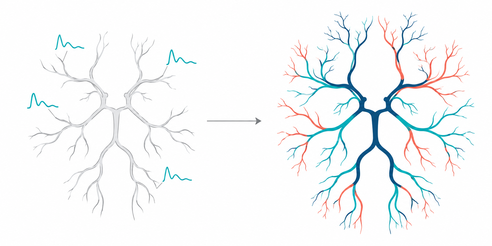
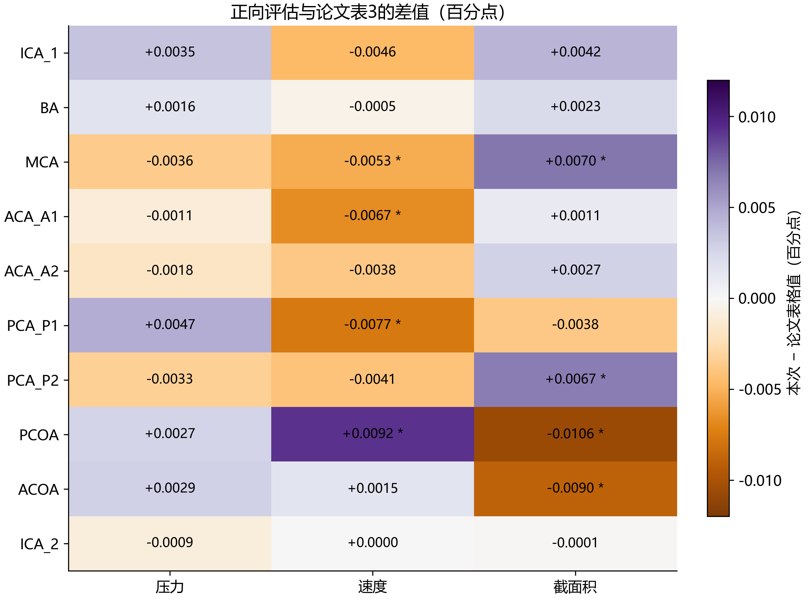
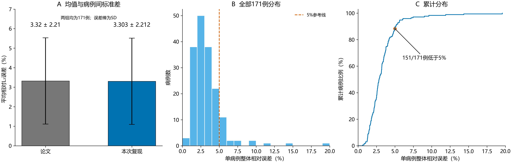
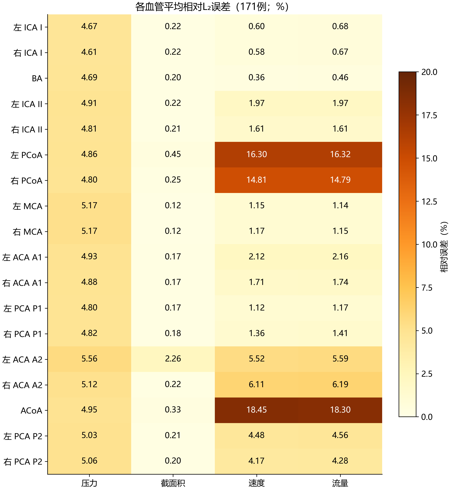
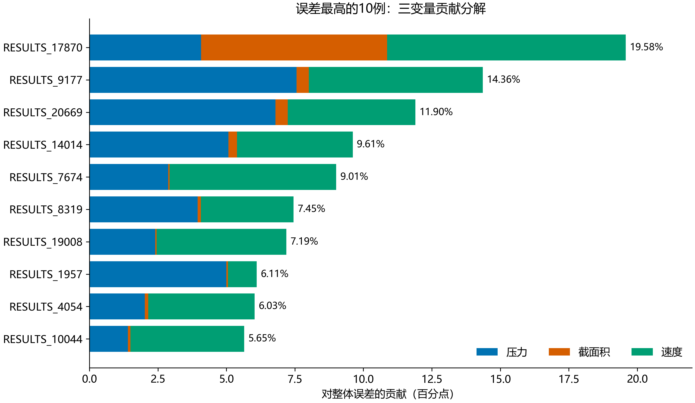
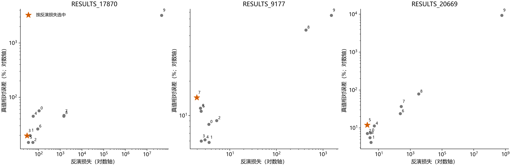
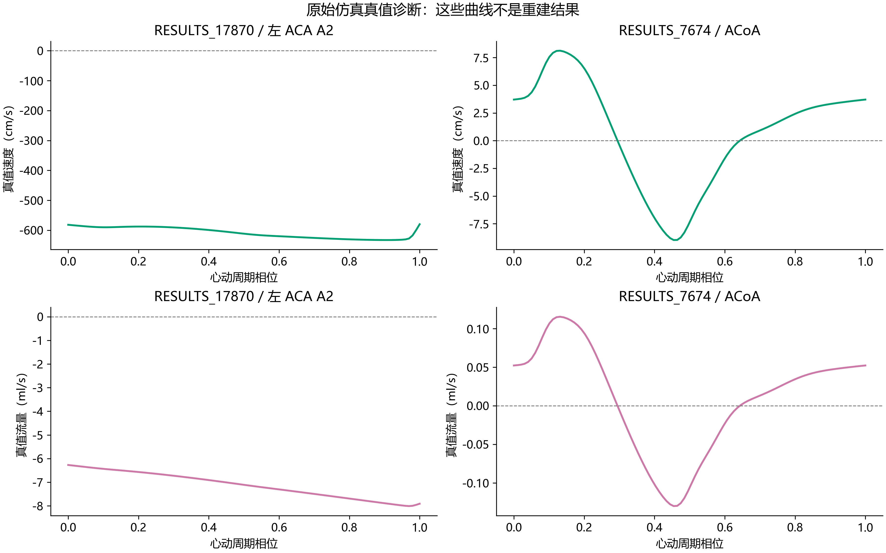

+++
date = '2026-10-20T13:40:43+08:00'
title = 'Reconstructing cerebral hemodynamics from sparse data using Neural Operator Transformers 复现'
slug = 'cerebral-hemodynamics-neural-operators'
categories = ["科学机器学习"]
tags = ["血流动力学"]
description = "使用 GNOT 与 VANO 复现稀疏数据下的脑血流动力学重建。"

+++

## 脑血流重建论文复现汇报与方法分析

研究对象为Kaczmarek等发表于Computers in Biology and Medicine的论文 Reconstructing cerebral hemodynamics from sparse data using Neural Operator Transformers。

**本次在CFFF平台单卡A100使用作者公开GNOT和VANO权重，完成36,090条血管样本的正向评估和171个仿真网络的无噪声稀疏反演。反演平均相对L₂为3.303318%，病例间总体标准差为2.211696个百分点，与原文3.32±2.21%接近。核心无噪声整体精度已基本复现。**

我在复现过程中逐步形成了三个相互关联的问题：第一，血液不可压缩时，为什么同一时刻一段血管的流入和流出仍可不同；第二，只有少数位置的观测，模型为什么能够给出其他血管的压力和速度；第三，反演损失更小、整体误差更低，是否就意味着每条血管及其参数都更可信。下面将这三个问题贯穿物理方程、网络设计和结果分析，说明本次工作除了运行代码和核对数值之外，形成了哪些认识。

输出缺口、复现问题台账、参考文献及思考证据索引见[补充材料](/cerebral-hemodynamics-supplement/)；正文文献编号对应补充材料第3节。

### 1 代码数据和软件环境来源

| **资源** | **来源和本次状态** |
| --- | --- |
| 作者代码 | Wojtyjot/operator-cow；固定提交4cb845d4e5d13694740e228d0300bc4992eb84f0 |
| 公开权重 | GNOT\_FINAL\_BIG\_DATASET\_1\_PI.pt与VANO\_FINAL\_BIG\_1\_PI.pt，文件哈希固定 |
| 验证数据 | Zenodo 17326502；0.414 GB；171例、3078个血管数组 |
| 测试数据 | Zenodo 17326502；7.819 GB；36,090条血管样本 |
| 训练数据 | Zenodo 17325257；47.110 GB；已校验 |
| GPU与主要依赖 | A100-SXM4-80GB；Python3.10.12；PyTorch2.2.1+cu121；DGL2.0.0+cu121；NumPy1.26.4 |

文件大小按十进制换算，1 GB = 10⁹字节，保留三位小数。

本次正式运行的代码、数据、环境、缓存和日志均位于**LSF\_AI4S**工作区。原始验证包可以从已校验的公共数据缓存传入新目录。执行前做了真实PyTorch和DGL的CUDA前向、反向传播检查。

SimVascular是作者生成一维仿真数据所用的平台，svOneDSolver为相关开源一维求解器。本次直接使用已发布数据，没有运行这两个工具重新造数。固定作者提交中未找到完整网络输入deck、批量参数采样、筛选及张量导出流程，因此求解器开源仍不能代替完整生成。

### 2 论文研究问题与物理模型

论文针对有限观测下的脑血流重建：实际测量难以同时覆盖所有血管、所有位置和整个心动周期，尤其是压力和局部边界条件。作者在已知全网几何与部分速度波形的设定下，重建Willis环各目标动脉的速度u、截面积S和压力p，并进一步讨论出口Windkessel参数估计。

*图1 原论文图1的网络示意。完整造数网络与脑动脉目标区域。来源：Kaczmarek等，2025。*

一个计数细节：原文从0编号到32，总计33段血管。本次反演代码加载18条目标脑动脉。将完整生成网络、目标脑动脉网络和单血管样本混为一谈，会误解数据规模和任务难度。

物理真值由一维血流有限元模型生成，描述截面平均量随轴向位置和时间的变化。血管壁采用经验压力面积关系，固定材料系数通过半径参与力学关系。它没有直接解析三维局部涡流、横向速度分布或三维壁面剪切应力，因此本文的低误差只针对相应一维真值体系。

作者报告生成17,129次仿真，运行10个心动周期，并检查最后两个周期相对差异小于1%。文中又记载剔除2,873次非生理仿真。筛选前后总数与最终171个验证网络的关系仍需澄清。本次以公开验证包实际包含的171个完整网络为评价对象。

#### 2.1 流速、流量与截面积

为避免原文空间坐标与潜变量同用字母z造成混淆，以下推导把轴向坐标统一写成$x$，潜变量写成$\mathbf z$。物理量及其SI单位如下；本次数据中出现的cm、mmHg等单位仍须按实际导出规则换算，不能直接代入SI形式。

| 量 | 定义与单位 | 我在理解中重点区分的内容 |
| --- | --- | --- |
| $S(x,t)$ | 截面积，$\mathrm{m^2}$ | 随位置和时间变化，不能当成固定常数 |
| $u(x,t)$ | 截面平均轴向流速，$\mathrm{m/s}$ | 与截面中心的局部流速不同 |
| $Q(x,t)=S(x,t)u(x,t)$ | 体积流量，$\mathrm{m^3/s}$ | 守恒收支中使用的是流量，而非速度本身 |
| $p(x,t)$ | 压力，$\mathrm{Pa}$ | 压力水平与轴向压力梯度有不同作用 |
| $\rho,\mu,\nu=\mu/\rho$ | 密度、动力黏度、运动黏度 | 血液不可压缩的近似在这里体现为密度不变 |

这一划分解释了为什么分叉处不能直接要求各支速度相加守恒。若两支面积不同，即使流速相同，所携带的体积流量也不同；需要比较的是$uS$。同样，“速度减半”与“流量减半”只有在面积保持不变时才等价。[1，§2.1]

#### 2.2 连续性方程：流入与流出的差额由局部储血承担

取两端位置固定的小段血管$[x,x+\Delta x]$，忽略支流和管壁泄漏，管壁可以运动。其血液体积准确地写成

$$
V(t)=\int_x^{x+\Delta x}S(\xi,t)\,\mathrm d\xi.
$$

密度不变时，质量守恒可约去$\rho$，得到体积收支：

$$
\frac{\mathrm d}{\mathrm dt}\int_x^{x+\Delta x}S(\xi,t)\,\mathrm d\xi
=Q(x,t)-Q(x+\Delta x,t).
$$

当血管段足够短时，$V\approx S\Delta x$。由于两端固定，$\Delta x$不随时间改变，除以$\Delta x$并令其趋于零，即得原文式（1）：

$$
\boxed{\frac{\partial S}{\partial t}+\frac{\partial Q}{\partial x}=0.}
$$

我对这一步的关键认识是：不可压缩限制的是血液密度，并不禁止更多血液进入一个可以膨胀的容积。若流入为8 mL/s、流出为6 mL/s，局部积血速率为2 mL/s；这不是截面积增加了2 cm²。对于长度$L$固定的血管段，其平均面积$\bar S=V/L$满足$\mathrm d\bar S/\mathrm dt=(Q_{\mathrm{in}}-Q_{\mathrm{out}})/L$，还需要长度和持续时间才能计算面积增量。

式中$\partial S/\partial t$比较同一位置在不同时刻的面积，$\partial Q/\partial x$比较同一时刻不同位置的流量。沿正$x$方向流量减小，意味着局部流入多于流出，对应面积正在增大。两项的单位均为$\mathrm{m^2/s}$。若改成完全刚性的血管，仍假设不可压缩、无分支和泄漏，则$\partial S/\partial t=0$，同一时刻沿该段的流量必须相同；它仍可以整体随时间变化。这也说明“流量沿程相同”与“流量不随时间变化”不能混为一谈。[1，式（1）；本节为守恒关系的推导]

#### 2.3 动量方程：局部变化、动量输运和压力驱动不能互相替代

原文式（2）按上述记号为

$$
\frac{\partial Q}{\partial t}
+\frac{\partial}{\partial x}\left((1+\delta)\frac{Q^2}{S}\right)
+\frac{S}{\rho}\frac{\partial p}{\partial x}
=Sf+N\frac{Q}{S}+\nu\frac{\partial^2Q}{\partial x^2}.
$$

理解这条方程时，我先把它与质点加速度联系起来：一个血液质点的速度变化不仅来自固定位置的时间变化，还来自它流经不同位置时遇到的速度变化，即$\mathrm Du/\mathrm Dt=\partial u/\partial t+u\,\partial u/\partial x$。因此，即使流场不随时间改变，沿程加速或减速仍可存在，不能只保留时间导数。

截面速度分布的修正系数也有明确来源。若$v_x$是截面内的局部轴向速度，且平均速度为$u$，则

$$
\alpha=1+\delta=\frac{\int_S v_x^2\,\mathrm dA}{S u^2},
\qquad
\int_S v_x^2\,\mathrm dA=\alpha\frac{Q^2}{S}.
$$

均匀速度剖面对应$\alpha=1$；原文采用抛物线剖面，对应$\alpha=4/3$。它修正的是非均匀速度造成的动量输运，不是把体积流量乘以$4/3$。当$Q$和$\alpha$固定而$S$减半时，$\alpha Q^2/S$加倍，说的是动量通量项加倍；$Q$本身保持不变。完整轴向动量通量还包含常密度因子$\rho$。[1，式（2）及速度剖面假设]

压力项移到右侧后为$-(S/\rho)\partial p/\partial x$。若压力沿正$x$方向升高，该项指向负$x$方向，会对原本正向流动产生减速作用；它不要求流速立即变负。原文$N=-8\pi\nu$，所以摩擦项$NQ/S$的方向始终与有符号流量相反：当$Q<0$时该项为正，仍然是在阻碍负向流动。判断阻力应看它与流动方向的关系，不能仅根据正负号。

#### 2.4 压力—面积关系：模型闭合，也是压力推断的重要先验

连续性和动量方程中包含$S,Q,p$三个未知场，还需要管壁本构关系和初边值条件，才能构成可求解的问题。原文使用

$$
p-p_0=\frac{4Eh}{3r_0}\left(1-\sqrt{\frac{S_0}{S}}\right),
\qquad
\frac{Eh}{r_0}=k_1\exp(k_2r_0)+k_3.
$$

当$S=S_0$时，$p=p_0$；在给定几何下，面积增加对应压力增加。令$K=4Eh/(3r_0)$，则$\partial p/\partial S=(K/2)\sqrt{S_0}\,S^{-3/2}>0$。在相同参考几何和相对扩张状态下，更大的$K$意味着相同压力增量对应更小的面积扩张。

这也回答了我此前对“由速度恢复压力”的疑问：压力并不是从少数速度测量中直接读取的，而是通过壁力学、几何、边界条件及网络耦合共同约束得到的。若真实管壁性质偏离训练中的经验关系，模型即使拟合了速度，也可能给出有偏压力。固定的是经验系数，半径仍参与计算，因此不能写成所有血管具有完全相同的弹性数值。[1，式（3）—（4）]

#### 2.5 边界条件：决定网络如何分流，也缩小了反演未知空间

在零容积的理想连接点，作者施加流量守恒与压力连续。前者表达连接点不额外储血，后者是忽略局部连接损失后的建模近似，并不意味着整条血管各处压力相同。分流还取决于下游阻力等条件：只有在明确固定入口压力、总流量或其他边界量之后，才能判断某条支路阻力改变后各支流量怎样变化。

末端三元Windkessel关系为

$$
p+R_2C\frac{\mathrm dp}{\mathrm dt}
=p_v+(R_1+R_2)Q+R_1R_2C\frac{\mathrm dQ}{\mathrm dt}.
$$

其中电阻描述压力降与流量的关系，顺应性描述末梢的储血能力。反演中的全局总阻力$R_T$与总顺应性$C_T$并非独立未知量，原文固定$\tau=1.34\ \mathrm s$，令$C_T=\tau/R_T$。因此，只优化一个共享阻力并不等于同时独立识别了阻力和顺应性；固定衰减时间常数已经提供了强先验。[1，式（6）—（10）]

我对有限元“真值”的理解也因此更明确：有限元结果提供的是给定方程、几何、参数和边界条件下的参考解。周期末差异小于1%主要检查周期稳定，不能代替网格/时间步收敛，更不能代替真实测量验证。神经算子逼近有限元解、有限元离散逼近连续方程、方程模型逼近真实生理，是三个需要分别评价的层次。

### 3 GNOT和VANO如何组成反演框架

GNOT承担正向代理。对一条血管，模型接收入口速度函数、初始面积函数、50维网络及血管参数，以及查询坐标，再同时输出p、S、u。网络背景通过参数向量进入模型，各血管在局部计算上分别处理。因此，这里的Transformer不能直接理解成已经解决任意新拓扑的通用血管图模型。\[1,2\]

VANO承担波形先验。一个100点入口速度时间序列由16维潜变量及血管类型条件生成。反演不再独立搜索100个时间点，而是在低维潜空间调整入口波形。这样可以减少优化自由度，并使波形靠近训练分布；与此同时，未见病理波形可能无法被先验充分表达。

*图2 稀疏观测和全网重建的概念示意。*

反演时两个神经网络的权重保持固定。每个病例优化各未测入口的潜变量和全局总阻力，使输出匹配可观测速度，并满足分叉质量守恒、压力连续和初始面积约束。正向任务回答“给定输入时状态是什么”，反演任务回答“哪些未知输入能够解释观测”。真实使用场景通常缺少完整输入，因此仅测试正向预测还不能检验论文的主要重建能力。

**我的理解是，这项工作的价值主要在于把可微代理、生成先验和网络物理约束结合起来。准确性来自这几个部分的共同作用，也会共同继承训练分布和模型假设。低目标损失并不保证参数或全网状态唯一。**

#### 3.1 算子学习的对象，以及50维参数与时空网格的区别

为区分网络权重和案例输入，以下用$\omega$表示GNOT权重，用$\boldsymbol\theta$表示50维案例参数。单血管正向映射可示意为

$$
\bigl(\hat u,\hat S,\hat p\bigr)(x,t)
=\mathcal G_\omega\bigl[u_{\mathrm{in}}(\cdot),S_0(\cdot),\boldsymbol\theta\bigr](x,t).
$$

这使我区分了两种变化：给定同一案例，改变$(x,t)$是在查询同一解场；改变入口函数或$\boldsymbol\theta$是在改变案例，得到另一个解场。初始条件变化不会自动让既定查询坐标改变，解场可以在相同坐标上变化。训练完成后$\omega$固定，也不妨碍案例输入变化后中间特征和预测结果发生变化。[1，§2.2]

| 数据对象 | 本文典型形状 | 含义 |
| --- | --- | --- |
| 案例参数$\boldsymbol\theta$ | $50$ | 网络背景及血管相关参数，不是50个空间点 |
| 入口速度 | $100$个速度值 | 单条入口随时间的函数采样 |
| 初始面积 | $50$个面积值 | 单条血管沿空间的函数采样 |
| 查询坐标 | $5000\times2$ | $50\times100$个位置—时间坐标对 |
| 单血管输出 | $50\times100\times3$ | 三个通道分别为$p,S,u$，顺序以数据字段为准 |

因此，若仅把查询空间点改为25个、时间点仍为100个，三变量输出是$25\times100\times3$；只保留压力通道并保留通道维度时，才是$25\times100\times1$。50维案例参数仍是50维。查询网格的分辨率与案例参数维数是两个独立概念。函数输入在代码中还会附带采样坐标，其张量最后一维不能误当作输出的三个物理变量。[1，附录A；2，数据和模型入口]

#### 3.2 全网背景怎样进入局部血管预测

我此前提出的问题是：如果GNOT只处理目标血管自己的入口和初始面积，整个网络背景如何影响预测？固定版`models/mmgpt.py`的`GNOT.forward`给出了可追踪的路径：将$\boldsymbol\theta$复制到每个查询点，与该点的$(x,t)$拼接，再送入trunk MLP；入口波形和初始面积则由函数分支编码。这样，同一查询点在不同网络背景下会产生不同特征。[2，`GNOT.forward`]

这里需要区分论文架构叙述与公开实现：附录将参数描述为独立嵌入输入，固定版代码则把参数拼接到查询输入中。两者都使用网络参数背景，但信息进入网络的位置不同，不能将附录的每个张量形状直接当成当前代码的执行过程。使用全局参数也不等于模型正在沿真实血管图进行逐边消息传递。

从模块作用理解，交叉注意力让查询点从入口和面积信息中提取与当前预测相关的特征，自注意力让查询点特征交换信息，几何门控则按查询坐标组合多个MLP专家的输出。注意力权重是训练得到的特征关联，不应直接解释为具有生理单位的影响系数或因果关系。专家模块的作用也需要实验判断，不能仅凭存在多个专家就认为各专家自动对应某一种生理机制。

原文采用线性化注意力，不能直接套用通常对token分数做softmax的标准Transformer公式。固定版代码先在特征维归一化query和key，再进行归一化点积加权；此外，正文写$K=8$个专家，而附录表A.12及维度说明写$K=4$。本稿保留这一差异，不用其中一个数字覆盖另一处记载；实际复现仍以固定代码和权重配置为准。[1，式（11）—（14）、附录A；2，`LinearCrossAttention`与`MIOECrossAttentionBlock`]

#### 3.3 VANO编码器需要完整入口，与稀疏反演并不矛盾

这个疑问需要把训练和应用分开。训练时，仿真数据提供完整入口，编码器把波形映射为潜变量分布的均值和方差；训练好的解码器学习如何由潜变量及血管类型生成波形。患者或验证案例反演时，不必先提供未知入口给编码器，而是直接初始化潜变量，再通过解码器生成候选入口，由观测和物理约束决定怎样调整。[1，§2.3—2.4；2，`VANO.encode/decode`]

$$
\text{训练：完整入口}\longrightarrow q_\phi(\mathbf z\mid u)
\longrightarrow\mathbf z\longrightarrow\hat u,
$$

$$
\text{反演：待优化的}\mathbf z_i
\longrightarrow\mathcal D_\psi(\mathbf z_i,c_i)
\longrightarrow u_{i,\mathrm{in}}(t)
\longrightarrow\mathcal G_\omega\longrightarrow\text{观测与物理损失}.
$$

其中$c_i$是血管类型条件。潜变量的每一维不必对应一个能直接命名的生理量，因此不能把“潜变量不同”直接等同于“血流解不同”，仍需比较解码后的入口和预测解场。

**16维也不是物理定律推导出的必然值**。作者在附录A说明依据初步实验，平衡波形重建精度与反演效率；但没有给出系统的多维度扫描来证明16优于所有更小或更大的选择。维度太小可能表达不了新波形，太大可能增加优化难度。现有材料支持它是作者选择的工作配置，不支持它具有普遍最优性。[1，附录A，表A.13]

#### 3.4 重建项和KL项分别解决什么问题

原文式（16）包含解码输出的平方范数、与真实输入的内积以及KL正则。在采用一致离散内积和采样权重时，可利用恒等式

$$
\frac12\|\hat u\|^2-\langle\hat u,u\rangle
=\frac12\|\hat u-u\|^2-\frac12\|u\|^2
$$

解释其重建部分：右侧最后一项不依赖网络参数，因而优化方向与对应平方重建误差相同。这个解释需要保留原式的采样、求和和平均约定，不能把其他VAE实现中的常数和权重直接搬来替换本文。

重建项鼓励每条训练波形被准确表达；KL项则约束编码后的分布，使其接近高斯先验，令不同输入的潜变量空间具有可用于采样的组织。缺少后者时，能重建已见波形不代表任意潜变量都能生成合理波形；正则过强时，又可能损害波形表达。原文表A.13给出$\beta=0.001$及每次期望估计16个Monte Carlo样本，属于训练设置，不是本次重新选择或验证的参数。[1，式（16）、表A.13；2，`train_new.py/train_batch_VANO`]

我的判断是，VANO带来的收益与限制必须一起报告：它把搜索限制在学到的波形族中，减少自由度，但无法保证覆盖训练分布外的病理入口。表5及图6中生成与训练波形的MFV、PSV、EDV和PI统计量接近，支持生成样本具有相似的若干特征；这既不等于两个完整分布相同，也不能单独证明VANO比直接优化100点或使用PCA更有利于最终反演。后者需要专门消融比较。[1，§3.3、表5、图6]

#### 3.5 这套组合为什么仍值得作为研究基线

我对模型的评价并不只在于寻找局限。首先，GNOT将一次较大的离线训练成本转化为跨案例复用的正向预测能力，使反演可以重复调用同一模型，无需为每个案例重新训练整套网络。其次，VANO提供低维、可微的入口表示，使100点波形搜索变成16维搜索。第三，单血管代理通过网络连接约束参与联合反演，使局部观测能够影响与之耦合的未测位置，而不只是对已测波形做插值。

本次171例的整体表现说明这套组合在既定同源仿真条件下具有可用性，但还不能分离上述各组件的贡献。因而，更合理的下一步是以它为固定基线，逐项改变先验、观测或约束，解释收益来自哪里，而不是在每次修改中同时更换多个模块。[1，§2—3；R；本段为方法评价]

### 4 实验输入与反演执行协议

| **信息类别** | **公开实现中的具体设定** |
| --- | --- |
| 已知根部入口 | BA及左右ICA I，共3条完整速度波形 |
| 内部速度观测 | 双侧MCA、ACA A1、PCA P1中点，共6处，每处100个时间点 |
| 几何与面积 | 全网长度、半径、心率等信息；每条血管50点初始面积 |
| 查询网格 | 50个空间点 × 100个时间点 |
| 反演未知量 | 其余入口的16维潜变量和全局总阻力 |
| 初始化和优化 | 随机种子2137；10个重启；每例600轮；学习率0.1 |
| 损失权重 | 观测0.1，质量1，压力10⁻⁸，面积100 |
| 执行方式 | 实际同时批处理2个重启；Windkessel关闭 |

“稀疏”主要指速度测量所在的血管与空间位置较少。它仍依赖全网几何、初始面积和完整时间波形，不能概括为只输入三个速度数值。若减少这些已知条件，就已经改变了问题，应作为新的实验协议。

公开实现先做两轮只更新总阻力的预热，再依次优化有观测、无观测及联合参数。本次保留并记录这个执行细节。与论文文字协议的差异没有通过追求目标数值而悄悄调整。

每例从10个重启中按反演复合损失选择最终解，仿真真值误差只用于事后评价。171例的选择规则均核对通过。此前原代码在每次构造时重置Torch种子，本次改为入口统一设种子并保存RNG状态。该修复会改变原脚本初始化序列，因此本轮不宣称逐比特复现公开原脚本。

#### 4.1 真正被优化的变量与梯度路线

18条目标血管中，只有3条根部入口直接给定，其余15条入口需要生成。六处内部速度观测位于血管中点，并不等于已知这六条血管的入口。因此，标准设定的优化变量数为

$$
15\times16+1=241,
$$

即15组潜变量加共享总阻力$R_T$；初始面积作为已知约束，$C_T$由固定$\tau$与$R_T$确定。50维网络输入向量、241个待优化标量以及每条血管5000个查询点，是三个不同层面的计数。

原文四项损失可示意写为

$$
\mathcal L_{\mathrm{inv}}
=\lambda_{\mathrm{mes}}\mathcal L_{\mathrm{mes}}
+\lambda_{\mathrm{mass}}\mathcal L_{\mathrm{mass}}
+\lambda_p\mathcal L_p
+\lambda_{S_0}\mathcal L_{S_0}.
$$

| 损失项 | 约束位置与对象 | 我对其作用的理解 |
| --- | --- | --- |
| 观测匹配 | 六条血管中点的速度时间序列 | 将候选解与实际可获得的局部信息联系起来 |
| 质量守恒 | 分叉/汇合处各支$\hat u\hat S$的有符号收支 | 防止各单血管预测在连接处出现不一致的流量 |
| 压力连续 | 同一连接点各血管端点压力 | 把局部预测约束为相互连接的网络状态 |
| 初始面积 | 各血管$t_0$时刻的面积与给定面积 | 固定解场的一部分几何/状态信息，并经代理关系影响其余变量 |

这里是对式（18）—（22）的作用解释，具体求和、采样和归一化仍以原式及固定版代码为准。特别是，这些物理惩罚主要作用于接口与初始状态，不等于在反演时显式检查整个血管内部的PDE残差。域内物理主要通过仿真训练数据被代理模型学习；同时预测三个物理量也不自动保证它们严格满足连续性和动量方程。

网络权重固定后仍可计算对输入的导数。对某条未知入口，梯度的示意链为

$$
\frac{\partial\mathcal L}{\partial\mathbf z_i}
=\frac{\partial\mathcal L}{\partial\hat{\mathbf y}}
\frac{\partial\hat{\mathbf y}}{\partial u_{i,\mathrm{in}}}
\frac{\partial u_{i,\mathrm{in}}}{\partial\mathbf z_i},
\qquad \hat{\mathbf y}=(\hat p,\hat S,\hat u).
$$

所以，“没有未测血管的真实答案”并不妨碍求梯度：方向由可见观测和物理惩罚经代理模型传回，而不是由未测真值误差传回。但可求导只保证存在一个可计算的更新方向，不保证代理导数准确、优化到全局最优，或未测血管被唯一确定。[1，§2.4；2，`inverse/COW.py`]

#### 4.2 损失权重的大小不能直接解释为物理重要性

压力项权重$10^{-8}$看似很小，但各项原始量纲、数值尺度、采样数和梯度尺度不同，不能据此说压力连续几乎没有作用。同理，面积权重100也不等于其生理重要性是观测项的1000倍。需要同时检查加权前后的损失、梯度和消融结果。三阶段优化是在逐步引入耦合变量以改善收敛，并没有改变最终未知信息不足的可能性。[1，式（18）及附录C]

### 5 实际复现过程与时间成本

| **时间** | **工作** | **证据或交付** |
| --- | --- | --- |
| 10月7至10日 | 论文预审、代码检查及A800前期试跑 | 修复清单、首例链路及历史报告 |
| 10月12日 | 建立A100新工作区并开始正式任务 | 环境验收、原始数据完整性检查 |
| 10月13日 | 完成完整正向及重算 | 36,090样本和表3逐项对照 |
| 10月14日07:10 | 训练集下载校验完成 | MD5匹配，约47.11 GB |
| 10月12至18日 | 完成171例及结果校验 | 原始断点、逐例日志、图表和异常病例 |
| 10月18日10:00 | 完成基线验收归档 | 54个报告文件校验通过 |
| 10月21日 | 只读复核状态，形成正式汇报 | 171例完成状态与数据校验仍可读取 |

171条单病例计时记录均值为2,685.92秒，即44.77分钟，中位数约41.27分钟。总记录时长约127.58小时，即5.32天。流水线记录约459,693秒，也约5.32天，但其计时范围包含阶段流程，不能与GPU实际忙碌时间混用。

论文单例报告1,180.44秒，约19.67分钟，本次为其约2.28倍。硬件、并行批处理、软件环境和计时范围没有统一，因此这个差值不应直接归因于A100比作者GPU慢。正向端到端评估为698.43秒，包含加载和归一化，且当时与反演共享GPU，也不能当作单次预测速度。

下载阶段既有文件大、跨站传输不稳定的客观因素，也暴露了续传实现问题：curl内部重试可能回到该次调用的初始偏移。改成外层重试并从当前文件大小继续后，能够保留新收到的字节。所有数据最终均经校验；下载进度不能仅以磁盘文件大小判断。

### 6 正向评估结果与归一化问题

完整测试集包含36,090条血管样本，每条使用50×100网格。按作者正向入口的测试集统计量归一化后，样本加权平均相对L₂为0.721626%。表3的30项指标中22项在两位小数上相同，压力10项全部相同，速度和面积各6项相同。\[1,2,R\]

*图3 正向表3的30项差值。星号表示本次四舍五入至两位小数仍与论文不一致，共8项。最大绝对差0.010620个百分点。来源：本次正向协议审计。*

此前使用反演脚本固定归一化常数得到0.514080%，按10种血管类型等权汇总又得到0.755778%。这些值来自不同口径，不能解释成模型提升。论文表3已舍入数值按本次样本数加权为0.722222%，与正文0.74%并不完全一致，其来源仍待澄清。

更关键的问题是，作者正向入口使用测试集Y的均值和标准差进行归一化和反变换。这利用了测试标签分布信息，构成评价中的信息泄露。本次为了核对公开实现保留该设置并明确披露。未来应保存训练归一化器并固定使用，再单独报告严格独立测试结果。

#### 6.1 同一权重为什么会得到不同的评价数字

归一化不仅是把最终误差换一个单位。若模型输出归一化变量$\hat y'$，物理输出为$\hat y=\mu+s\hat y'$，改变$\mu,s$会改变反变换结果；若输入的归一化也变化，还会改变模型实际接收的特征。固定训练好的网络后，随意更换统计量通常不能视为等价变换。因而，本次0.514080%与0.721626%的差别首先说明评价路径敏感，不能解释成相同协议下模型性能提高。[2；R，正向协议审计]

相对L₂的基本定义是

$$
e_y=\frac{\|\hat y-y\|_2}{\|y\|_2}.
$$

它比较整组采样值的误差能量与参考信号能量，不是逐点百分比误差的平均，更不是分类准确率。因此0.74%不能改写成“准确率99.26%”，也不意味着每个位置和时刻的误差都低于0.74%。此外，样本加权与类型等权对不同血管赋予的权重不同；任何总体数字都应同时说明分母与平均顺序。[1，式（15）、§3.2；R]

#### 6.2 正向误差小，为何仍不能直接推断反演同样准确

正向测试把完整入口等信息交给模型，主要考察给定输入时解场是否准确。反演则要从不完整观测恢复输入，再计算未测结果。若不同输入在观测位置产生相近输出，即使正向代理很准确，反演也可能不稳定。反演误差还可能由入口先验限制、优化未收敛和代理误差共同造成。

因此，本次正向0.721626%与反演3.303318%不能简单相减来估计“优化器造成了多少误差”。这两个实验的输入已知程度、样本单位和统计范围不同。若要分离原因，需要在同一案例上分别使用真实入口、反演入口，并在可能时以原始物理求解器回代；这些分解实验本轮尚未开展。

### 7 全部171例反演的整体结果

*图4 论文与本次结果对照、完整误差直方图和累计分布。本次误差棒采用病例间总体SD；论文按其报告的±2.21%绘制，原文未明确SD计算分母。两组均为171例。全部病例进入统计。来源：本次原始断点和逐血管误差重算；论文参考值见§3.4。*

| **指标** | **本次** | **解释** |
| --- | --- | --- |
| 均值与总体SD | 3.303318%和2.211696个百分点 | 原文为3.32±2.21% |
| 中位数和Q1/Q3 | 2.851%；2.074% / 3.898% | 体现典型病例与分布 |
| 低于5%的病例 | 151/171，88.30% | 5%为描述性参考线，非临床阈值 |
| 95百分位与最大值 | 5.841%；19.581% | 尾部误差不能由均值替代 |

每个病例的总体误差先对18条血管、p/S/u三个变量的54项相对L₂等权平均，再对171例求平均。流量Q另列，不参与3.303%的整体指标。由逐血管记录重算与原始断点的最大差为4.13×10⁻⁸，处于浮点舍入量级。

均值与论文仅相差−0.016682个百分点，支持核心整体精度基本复现。但这不是统计等效性检验，没有作者逐病例预测可做配对核验，也不能把更小的平均数字解释为本次优于作者。

#### 7.1 3.303%的计算对象与适用边界

对病例$c$、血管$a$和变量$k\in\{p,S,u\}$，设$e_{c,a,k}$为同一时空网格上的相对L₂。当前整体指标可写为

$$
E_c=\frac1{18\times3}\sum_{a=1}^{18}\sum_{k\in\{p,S,u\}}e_{c,a,k},
\qquad
\bar E=\frac1{171}\sum_{c=1}^{171}E_c.
$$

这使我意识到，整体均值把不同大小、不同功能的血管及三个变量等权汇总，并不自动对应某个临床任务的重要性。它也包含有观测和无观测的血管，不能直接改称“完全未测血管平均误差3.3%”。若研究目标变为侧支血流或未测压力，就应预先定义对应子集和目标量，并保留原指标作为基线。[R，`metrics.json`与逐血管CSV]

病例间SD反映不同仿真案例的误差差异，不是某一患者预测的可信区间，也不是均值的置信区间。与论文均值、SD接近，支持复现了相近的总体表现；尾部、变量分解和局部失败是否一致仍需要更细的证据。

### 8 变量与血管分解后的解释

*图5 18条血管的平均相对L₂，分别列出压力、面积、速度和流量。全部171例参与。此图不是论文表6至9的绝对MAE。*

全网平均误差分别为压力4.936%、面积0.330%、速度4.644%、流量4.677%。面积较容易重建，拉低了三变量等权平均值。因此，3.3%并不意味着每个变量、每条血管都达到相同精度。

交通动脉速度误差较高：ACoA为18.45%，左PCoA为16.30%，右PCoA为14.81%。低流量或往返流动可能减小相对误差分母；优化失败、代理误差及模型失配也可能参与。后续应同时报告绝对单位误差、波形形态和流向，避免仅用相对百分比评价这些位置。

#### 8.1 面积最准确，是否说明模型对面积的学习能力最强

我认为目前只能确认“在本协议和本指标下，面积误差最低”。全网初始面积本来就是已知输入，并且反演有面积约束；面积波形又围绕非零参考面积变化。因此，较小的相对面积误差可能同时受已知信息、变化幅度和误差分母影响，不能直接归因于网络天然更擅长面积，也不能证明压力已同样准确。这个解释需要减少面积先验、改变面积项或分离脉动部分的消融才能验证。

压力同样含有较大的基线。整条压力波形相对L₂较小时，脉压或收缩期峰值仍可能存在明显偏差。后续若保存逐点输出，应同时报告mmHg单位的MAE、收缩压/舒张压误差和脉压误差，而不只报告完整波形的相对范数。当前输出缺口不支持补算这些数字，故本稿只提出评价方案。

#### 8.2 交通动脉为什么既难预测，又不能被整体均值掩盖

往返流动的时间平均值接近零，不等于其L₂范数接近零。相对误差分母包含各点速度的平方；较大的正负摆动可以相互抵消均值，却不会抵消范数。因此，判断“分母较小”应检查RMS或实际范数，而不能只看平均流速。

另一个值得验证的机制是目标函数的信息分配：交通动脉直接观测较少，且绝对流量可能较小，在基于绝对流量收支的损失中，其误差可能不易占据主导。但这些血管对侧支通路很重要，数值上贡献较小不等于研究价值较低。提高它们的损失权重也未必能解决问题——如果当前观测不能区分不同侧支流型，需要的是额外信息或更合适的先验。上述属于机制假设，本次尚无消融能够确定各因素的贡献。[1，Discussion；R，图5及交通动脉误差]

我据此认为，更有解释力的评价应同时给出全网指标、未测血管指标和交通动脉目标指标。流向判断还应为接近零流量的区间预先设置处理规则，避免把极小数值的符号改变直接判为显著生理错误。

#### 8.3 速度和流量误差接近，能说明什么

由$Q=Su$可得一个不需要除以接近零流速的误差分解：

$$
\Delta Q=S\,\Delta u+u\,\Delta S+\Delta S\,\Delta u.
$$

本次面积误差整体较小，速度与流量平均相对误差接近，与速度误差在流量误差中发挥主要作用的解释相容。但误差符号、相关性和各自分母仍会影响结果，不能只由两个总体均值反推出逐点贡献；需要预测场才能进一步分析。

### 9 较差病例和局部误差贡献

*图6 最差10例及压力、面积、速度对整体误差的贡献。堆叠段之和等于该病例的整体三变量误差。未剔除或替换任何病例。*

RESULTS\_17870的整体误差为19.581%，其中左ACA A2面积相对误差348.137%，该血管三变量合计贡献9.113个百分点。RESULTS\_9177为14.358%，RESULTS\_20669为11.897%。这些尾部结果说明全网平均会稀释局部异常。

RESULTS\_7674的ACoA真值速度RMS约4.83 cm/s，并存在往返流动，速度相对误差约275.31%。其低信号范数是解释高相对误差的证据之一，但仍需要逐点预测检查误差发生在哪些时间和位置。当前结果导出不足，限制了这一进一步分析。

本次没有为了改善总体指标排除较差病例。异常数据可以标记并另做敏感性分析，但主队列定义应预先固定，任何排除都需要有独立于结果好坏的依据。

我对RESULTS\_17870的进一步理解是，应把“参考数据是否合理”和“算法是否正确解释了参考数据”作为两条独立检查线索。仅左ACA A2面积这一项的348.137%，在54项等权平均下就贡献约$348.137/54=6.447$个百分点；这说明局部异常能够解释整体误差的一部分，但不能单独说明异常来自真值、优化还是代理模型。第11节的方向与筛选疑点需要独立追溯，不能用“真值可能有问题”替代对重建失败的分析。

### 10 多次初始化与目标函数的局限

*图7 最差3例的10次重启。星号为公开算法按复合损失选中的重启，真值误差仅用于事后诊断。来源：本次重启日志。*

10次初始化中，损失排序与真值误差排序并不总一致。例如RESULTS\_9177按损失选中的重启编号为7，其真值整体误差约14.36%；其他重启可以有更小真值误差，但在实际反演时真值不可获得，不能据此替换主结果。

这一现象提示观测匹配与全网准确性并不等价。在稀疏观测条件下，不同参数组合可能产生相似可见输出，未测血管仍可能差异很大。与此同时，损失权重、优化充分程度及代理误差也会影响排序。当前证据不足以把原因唯一归为反演非唯一性。

我的理解是，后续研究应保留每个重启的参数、场和各项损失，分析多个近最优解之间的差异。若这些解在可测位置相近、在未测位置分歧明显，应报告不确定性或通过观测设计增加约束，而不是只选择一个结果给出确定性图像。

本轮对171例均验证了按反演目标选重启的规则；真值没有用于结果选择。该检查比仅核对最终均值更能确保评价过程可解释。

#### 10.1 多初值结果可以诊断什么，不能直接证明什么

对相近反演损失的多个解，至少存在三类需要区分的情况：其一，解码波形和解场也相近，只是潜变量坐标不同；其二，可测输出相近，但未测血流明显不同，提示数据对目标量的约束可能不足；其三，观测项或物理项仍明显不同，更多反映优化、权重或代理误差问题。只有导出每个候选解的场与分项损失，才能进一步区分。

十次随机初始化也不构成十个后验样本，其频次没有自动对应概率意义。VANO训练中存在变分分布，并不意味着本文已经得到给定患者观测后的$p(\{\mathbf z_i\},R_T\mid\mathbf y)$。因此，本次可报告“初始化敏感性”和“候选解分歧”，不能据此构造标称95%的贝叶斯可信区间。

这一认识改变了我对“最小loss就是最好结果”的理解：它是在既定目标函数下选解的合理规则，但目标函数只包含当前可用的信息；它与未测真值误差的联系，需要通过独立数据评价，而不能在运行时利用真值去替换选中的重启。

### 11 原始仿真真值的质量疑点

*图8 两个较差病例的原始真值诊断，只展示保存网格中点的真值曲线。此图不包含本轮预测，不应作为重建波形效果图。*

所有3078个数组均具有预期网格、数值有限且面积为正。其中，RESULTS\_17870/L\_ACA\_A2.npy是唯一满足“末端血管在全部50×100保存点中Q=S×u均小于0”标记条件的数组，其速度RMS约624.71 cm/s。

原文§2.1.3描述筛除末端持续负流量的非生理仿真，这与该公开文件的表面表现不一致。但是负号也可能涉及方向约定，筛选实现或数据版本也可能发生变化，因此本次不能据此判定论文错误。该例仍保留在171例主结果中。

若联系作者机会有限，建议优先询问这一有文件名、有计算规则的问题：该验证文件的方向约定是什么，为什么会通过原文描述的筛选，该公开包是否对应同一版筛选后的数据？可以附真值图和审计规则，不应在提问前先给出错误结论。

### 12 对论文设计与局限性的理解

#### 12.1 固定拓扑和参数编码

论文在固定网络及采样分布内学习。缺支或完全闭塞可能改变有效连接关系；狭窄首先改变局部几何、阻抗和能量损失，并不必然改变网络拓扑。当前GNOT的50维全局编码和血管类型条件并未自动提供任意拓扑的处理能力。可行研究应先定义少量可控变体，区分几何变化与连接变化，以网络为单位划分数据，并用未见拓扑测试。

#### 12.2 壁力学关系的个体差异

准确的表述是采用共同经验关系和固定材料系数，而不是每条血管弹性数值完全相同，因为半径参与关系。个体硬化等变化未作为独立材料差异系统建模。若把材料参数也放入反演，需要验证它与阻力、几何和压力的相互补偿，否则测量匹配很好也可能不能唯一识别材料。

#### 12.3 观测噪声与信息缺失

原文所测试的零均值随机扰动未覆盖TCD中的增益偏差、角度偏差、漂移、时间错位或连续丢失片段。我对“高斯噪声是否合理”的认识是：它可以作为受控随机误差基线，但“高斯”不等于“各时刻独立”，也不排除误差相关结构；应分别核对均值、幅值、时间相关性及测量机制。更经济的切入点是先在现有模型上定义一种结构化误差，保持总误差能量可比，观察其对压力和交通动脉重建的影响。相关假设需要实验，不宜直接宣称模型能或不能用于真实TCD。

噪声强度的单位与SNR也需要明确。原文将0.4、0.8描述为信号方差的乘子，并给出约25、11 dB的SNR。对同一信号，若噪声功率严格为$P_n=\alpha\operatorname{Var}(u)$且使用$\mathrm{SNR}=10\log_{10}(P_s/P_n)$，$\alpha$从0.4加倍为0.8只会使SNR下降$10\log_{10}2\approx3.01$ dB。这与两个报告数值的差别不能直接对应，需核对实际加噪公式和SNR定义；目前属于报告口径待澄清，而不是据此认定噪声实验无效。本轮无噪声基线也没有检验噪声鲁棒性。[1，§2.4、附录C/D；2；R]

#### 12.4 同源仿真与数据泄露应分开判断

训练和测试由同一求解器产生，主要限制外部有效性，并不自动证明训练样本进入测试。实际样本泄露需要检查网络ID或共享生成因素。另一方面，公开正向入口使用测试标签统计量是已发现的具体信息泄露。当前尚未完成全训练、测试、验证网络ID交集审计，也未完成固定训练统计量的独立测试。

我的研究判断是，最先值得做的是修正评价和导出，再研究结构化噪声、观测位置与反演不确定性。拓扑泛化和三维验证潜在价值更大，但需要新的数据生成与外部测试体系，不能只换一个网络模块就认为问题解决。

原文按85:14:1划分训练、测试与验证数据，不同集合分别服务于网络训练、正向评估和逆问题评估。附录C又说明使用验证集中的10个CoW选择反演损失权重，但这10例与最终171例统计是否完全分离，当前材料尚不能确认。使用验证数据调参本身合理；需要澄清的是，最终性能估计是否另有未参与选择的数据。不能将“未参与网络权重训练”自动等同于“从未参与任何超参数选择”。[1，§2.1.3、§3.4、附录C]

#### 12.5 出口压力拟合好，不等于Windkessel参数识别准确

原文§2.5在重建完成后，以代理预测的出口$Q(t)=S(t)u(t)$和$p(t)$拟合Windkessel参数：固定$R_1$，搜索$R_2,C$，使ODE生成的压力接近重建压力。这个拟合目标不是直接测得的患者出口压力，因此存在从解场重建到出口参数再到物理回代的误差传递链。

表11提供了一个值得区分指标的例子：左MCA的顺应性从参考$1.75\times10^{-10}$变为重建$1.26\times10^{-10}\ \mathrm{m^3/Pa}$，相对差约28%，而压力拟合误差报告为0.37%。二者对应的评价对象不同，不能把0.37%写成顺应性参数误差。这个例子提示参数恢复与输出拟合必须分别检查，但它本身还不足以严格证明存在多组等价参数。[1，§2.5、表11]

本轮Windkessel功能关闭，也没有FEM回代结果。对该步骤的认识来自原文和源码审查，不能并入本次已经复现的实验成果。后续若开展，应先确认使用的确实是重建出口场，再检查参数单位、ODE压力误差、参数误差以及回代后的全网误差。

#### 12.6 与2026年近邻工作的联系：哪些改进已有先例

Ryan等2026年的《Physics-Informed Neural Operators for Parameter Inference in Multi-vessel Cardiovascular Networks》明确引用本次复现论文为参考文献[19]，但作者团队不同，是相关路线上的独立工作，不能称为同一GNOT/VANO代码的直接第二版。[7]

| 比较维度 | 本次复现的2025年工作 | Ryan等2026年工作 | 我的判断 |
| --- | --- | --- | --- |
| 研究对象 | CoW脑动脉网络，包含交通动脉及往返流动 | 17条血管的体循环动脉网络，Fontan患者设定 | 前者更贴合本项目的侧支血流问题 |
| 入口生成 | VANO，生成各未知血管入口 | WAE，表示网络根部入口，并比较VAE/PCA | 后者提供了更明确的生成器比较；八条原始波形仍限制其证据范围 |
| 代理物理约束 | 主要以仿真数据训练，反演时约束接口等关系 | 训练中直接加入PDE、入口及分叉残差 | 后者约束设计更全面，但不能由此推定在CoW任务上必然更准 |
| 患者反演 | 多初值优化后选择一组解 | 联合推断物理参数、入口潜变量和误差参数，使用NUTS获得后验样本 | 后者能表达参数与预测不确定性，其可靠性仍取决于先验、误差模型和采样 |
| 与现实的偏差 | 测试加入随机噪声的合成观测 | 使用时间相关的Matérn偏差协方差及测量噪声 | 后者更明确地承认模型失配，也需防止偏差项与物理参数互相补偿 |
| 验证边界 | 系统的合成逆问题与噪声/分辨率实验；本次只复现无噪声部分 | 仿真实验及两例真实患者，压力与袖带收缩压/舒张压比较 | 真实病例提高应用相关性，但未验证所有未测血管或整条压力真值波形 |

借用该文的思路，概率反演可以示意为

$$
p(\boldsymbol\eta,\mathbf z,\boldsymbol\sigma\mid\mathbf y)
\propto p(\mathbf y\mid\boldsymbol\eta,\mathbf z,\boldsymbol\sigma)
\,p(\boldsymbol\eta)\,p(\mathbf z)\,p(\boldsymbol\sigma),
$$

其中$\boldsymbol\eta$在这里表示物理参数，$\boldsymbol\sigma$表示误差参数；符号为便于与本稿其他段落区分而改写。与只保留最小损失解相比，后验描述哪些候选解释受到观测和先验的支持，以及其分歧怎样影响未测结果。它不会自动消除不可辨识性；强先验或错误的偏差模型也可能产生很窄但有偏的区间。[7，式（28）—（31）；后一句为方法解释]

这项比较对选题的直接意义是：仅加入贝叶斯推断、相关误差或换用WAE，已经不足以作为本项目的独立创新依据。更需要解决的是，在CoW交通动脉这一具体目标上，哪些观测条件足以区分流向和流量，结构化误差会怎样破坏这种区分，以及新增什么可获得的观测能够改善结果。两篇没有相同协议下的直接比较，不能用发表年份或其各自的百分比误差排名。

#### 12.7 从本次证据出发形成可检验的问题

结合交通动脉误差、多初值排序和输出缺口，我将后续问题收紧为：**在已知几何和根部入口的前提下，少量内部速度观测能把未测交通动脉血流确定到什么程度？当某处观测存在一种明确的系统偏差时，哪些目标首先失去可靠性，增加哪条血管的观测最有帮助？**这是一条从现有结果产生的研究假设，不是已经完成的发现。[8]

目前医院数据能否获得尚不确定，因此预实验应以公开模型和仿真数据独立闭合。可以先保持三个根部入口已知，从六条内部候选观测中选三条，共20种组合；先用少量代表组合判断差异是否稳定，再决定是否扩大比较和设计选择算法。这一设定必须准确表述为“三个已知入口加三个内部观测”，不能简称为“仅三条观测重建全网”。

选点策略可使用已知几何、已经取得的观测和模型预测，不能用目标血管真值决定该病例的测量位置。应在验证集上设计规则，在独立测试网络上比较固定组合、随机选择和目标导向方法；必要时加入现有信息量准则作为对照。主要评价交通动脉绝对流量误差、流向及失败案例，同时保留全网基线。若组合差别很小，或简单固定组合已经足够好，则复杂自适应方法的必要性不足，应据此调整课题，而不是预设一定能得到提升。

### 13 后续工作与条件时间表

| **顺序** | **工作和验收** | **时间估计** |
| --- | --- | --- |
| 1 | 数值导出与绘图解耦，3至5例字段及MAE检查 | 配置和检查0.5至1天，计算约2.2至3.7小时 |
| 2 | 若需完整表6至9，重跑171例，保存逐点场并汇总 | 按实测约127.6小时，含核验预留6至8天 |
| 3 | 固定训练归一化器，审计网络ID交集 | 1至3天，取决于元数据可用性 |
| 4 | 选择一种结构化误差或少量观测组合，分析交通动脉目标量 | 先跑5至10例，实测后再安排全量 |
| 5 | 拓扑、壁力学与独立3D评价 | 单独确定数据和收敛标准，不承诺固定总工期 |

时间来自本次A100单例44.77分钟的线性估算，不是额外实验的实测承诺。新的分辨率、并行度、输出量和失败重试都会改变耗时。三维造数也不能把CPU从32核增加到128核后直接除以4，需要测单例强扩展和多病例并行吞吐。

目前已经完成的目标是公开权重核心基线验证。按10月18日确认的范围，本轮没有从头训练GNOT/VANO，没有运行噪声、降采样、Windkessel及FEM回代，也没有启动这些实验的自动队列。若导师需要全论文所有工作，应在新范围中逐项恢复验收标准和预算。

联系作者建议集中于两项可复核问题，优先级最高是RESULTS\_17870的数据方向与筛选记录；如仍有机会，再询问固定训练归一化器、数据划分ID及论文表3原始汇总口径。完整造数输入deck等需求可等后续确定新数据研究方向后提出，避免一次要求过多材料。

**建议汇报结语：公开模型在171个同源一维仿真验证网络上的整体无噪声重建精度已基本复现。复现同时暴露了评价口径、结果导出和数据质量问题。下一步应优先补足这些证据，再以明确的独立测试设计开展改进。**

在方法认识上，本次学习使我从“输入少数速度即可得到全网答案”的直观印象，转向了更有条件的解释：模型利用已知几何、面积、壁力学、入口先验和连接约束，将有限观测补成一个候选解。约3.3%的同源仿真误差说明这套组合在既定条件下有效，却没有单独证明各组件必要、参数唯一或真实患者适用。对我而言，下一阶段的重点是把这些依赖条件逐项变成可检验的实验，而不是仅追求更小的汇总数字。

### 14 结果文件与复查入口

正式结果根目录为用户指定LSF\_AI4S工作区。其完整绝对路径如下，所有正式实验写入均限制在此目录内。

/cpfs01/projects-HDD/cfff-4a8d9af84f66\_HDD/linchensen/cpfs01/projects-HDD/cfff-4a8d9af84f66\_HDD/public/LSF\_AI4S

| **相对路径或文件** | **作用** |
| --- | --- |
| runs/clean-171/inverse/progress.pkl | 171例完成清单与整体误差，原始结果未被后续统计覆盖 |
| runs/clean-171/inverse/arteries\_log.pkl | 逐血管误差与反演相关记录 |
| logs/full-clean.log | 完整反演日志、各病例耗时和重启信息 |
| runs/baseline-verification-report/ | 详细验收报告、6幅图、CSV、证据和文件哈希 |
| config/fresh\_inverse.yaml | 正式反演配置 |
| provenance/reproduction-fixes.patch | 相对固定作者提交的修复记录 |
| provenance/final-baseline-audit-status.json | 最终验收状态和报告归档校验 |

原始progress.pkl的SHA256为a65fe040291c35da47bfc6b8891f13fa918384fb60a45d67c7bee1bc5422a59b。GNOT权重SHA256为e3fe6c8d615d596ef75502ba689e2c5dc64caea259007e57d11cfa1f9d015e1d。VANO权重SHA256为6851c784faaa9095350e42f65f7440989e412f7e474047efdc8110dc749ef092。

本地证据目录为fresh-a100-deployment/baseline-verification-report。metrics.json为最新数值摘要，current-scope.json为当前范围，tables/含逐病例和逐血管统计，evidence/含原始审计输入。该目录内保留的早期范围快照不应覆盖当前范围；以current-scope.json与本报告为准。

图表中的百分比是相对L₂，物理单位RMSE作为补充单列。凡涉及图8原始波形均标明“真值”，没有用真值曲线冒充预测。软件方法与图表整理使用了Scientific Agent Skills中的相关流程，其方法引用单列于参考文献，不作为脑血流模型性能证据。
