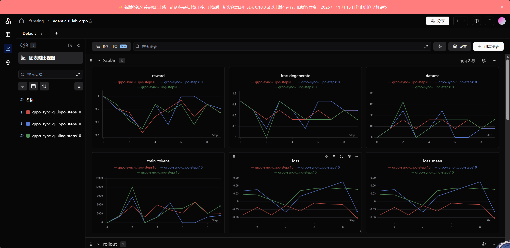

+++
date = '2026-11-17T00:00:00+08:00'
title = 'Agentic RL 学习笔记：从 GRPO 到 PPO、CISPO'
slug = 'agentic-rl-study-notes'
categories = ['大模型与应用']
tags = ['Agentic RL', 'GRPO', 'PPO', '强化学习']
description = '整理 SFT、GRPO、PPO、CISPO、LoRA 和在线策略蒸馏的入门笔记，结合 SwanLab 的三组短跑实验，理解奖励、退化组与有效训练信号之间的关系。'
math = true
+++

这次学习从一个看似矛盾的现象讲起：在 SwanLab 里，三个实验的第一步 `reward` 都达到了 1，但 `datums` 和 `train_tokens` 却都是 0。答得好，为什么没有可用于更新策略的样本？弄清楚这个问题，就能把 GRPO 的组内优势、PPO 和 CISPO 的更新目标，以及训练曲线上的几项指标串起来。

学习路线参考 [Datawhale · Agentic RL Lab：Getting Started（环境配置与基础概念）](https://datawhalechina.github.io/agentic-rl-lab/experiments/getting-started/)。

## 从 SFT 到 RL：训练信号来自哪里

监督微调（Supervised Fine-Tuning，SFT）使用已有的目标回答。在常见的语言模型训练中，交叉熵（Cross-Entropy）让模型提高目标 token 在给定上下文下的概率。强化学习（Reinforcement Learning，RL）则先让模型生成回答，再根据反馈更新生成策略。奖励可以来自规则、评分模型或环境；例如数学任务仍可用标准答案判分，但不用把完整参考解法当作逐 token 的训练目标。[^getting-started]

| 术语 | 在这类训练里的含义 |
| --- | --- |
| Policy（策略） | 给定上下文，模型为下一步动作或 token 输出的概率分布。 |
| Rollout（采样轨迹） | 用策略实际生成的一次回答；多轮任务还会记录动作与环境反馈。 |
| On-policy（同策略） | 训练数据由当前策略生成。常见做法是用本轮策略快照先采样，再用这一批轨迹更新。 |
| Off-policy（异策略） | 用不同于待优化策略的行为策略所生成的数据；旧权重只是其中一种来源。 |

## GRPO：奖励和优势是两回事

GRPO（Group Relative Policy Optimization）对同一道题采样多条回答，再为每条打分。`group_size` 是同一道题采几条回答，和每个 batch 放几道题不同。`reward` 表示一条回答得了多少分，**Advantage（优势）**则衡量它相对于同组基线的表现。Datawhale 的文本入门实验用组内均值作基线：[^grpo]

$$
\bar R=\frac{1}{G}\sum_{j=1}^{G} R_j,\qquad A_i=R_i-\bar R.
$$

例如，四条回答的奖励是 `1, 1, 0, 0`，组内均值为 `0.5`，优势就是 `0.5, 0.5, -0.5, -0.5`。组内优势提供了更新方向。在经典 PPO 的 Actor–Critic 实现里，这类基线通常由价值模型（Critic）估计；这里则直接用同题回答的奖励统计，省去单独训练 Critic。完整 GRPO 配方还常按组内标准差归一化；不要把入门 demo 的简化公式当成所有实现都一样。[^grpo]

如果四条回答全对，或者全错，它们的奖励虽然分别很高或很低，组内差异都为零。这就形成了**退化组（Degenerate Group）**。对这里的组相对奖励项而言，退化组没有更新信号。这也解释了开头的问题：高 `reward` 说明采样答案得分高，不保证这一批能提供可用的组内对照。[^grpo]

## 三种 loss：同样的优势，怎样更新策略

对同一个已采样 token，`sampling_logprobs` 是采样策略当时给出的对数概率，`target_logprobs` 是当前训练策略重新计算的值。对数把概率连乘变成加法；求概率比时，也可以先计算对数概率差，再取指数。[^loss]

$$
\rho_t = \exp\bigl(\log \pi_\theta(a_t\mid s_t)-\log\pi_{\mathrm{sample}}(a_t\mid s_t)\bigr).
$$

例如，`prob_ratio = 5` 表示当前策略对该 token 给出的概率是采样时的五倍。优势决定这条信号倾向于提高还是降低生成概率，概率比则反映两套策略对同一个 token 的判断差异。三种目标真正不同的是**怎样用这个比率**。[^loss]

| 目标 | 在这次学习中怎么理解 |
| --- | --- |
| Importance Sampling（IS） | 直接用概率比乘优势构造策略目标，让采样策略下得到的样本按当前策略重新加权。 |
| PPO（Proximal Policy Optimization） | 在原始代理目标与使用裁剪比率的版本之间取较保守的值，限制继续朝有利方向改动时能得到的收益。它并不硬性保证每个比率都在裁剪区间里。 |
| CISPO（Clipped Importance Sampling Policy Optimization） | 先裁剪比率，再把结果作为当前 `logprob` 与优势的权重。`detach()` 保留权重的数值，但当前这次反向传播不会沿比率计算梯度。 |

一个能区分 PPO 和 CISPO 的例子：优势为正、概率比已超过上界时，PPO 的裁剪分支可以让该项不再奖励继续提高概率；CISPO 则仍可通过当前 `logprob` 产生梯度，只是权重不再随比率继续增大。**这里比较的是 GRPO 组内优势如何接到三种 loss 上**，并不是在比较三套彼此独立的训练系统。[^loss][^grpo]

## 读 SwanLab：先看有多少样本真的进了训练

*图 1：文本 GRPO 同步实验的学习记录。红色为 CISPO，蓝色为 PPO，绿色为 Importance Sampling；各运行名称均标为 `steps10`，图中步数为 0–9。*

| 指标 | 读法 |
| --- | --- |
| `reward` | 先对每道题的回答取平均，再对当前 batch 的题目取平均；不是固定测试集成绩。 |
| `frac_degenerate` | 看有多少题的组内奖励完全相同。 |
| `datums` | 看实际送入训练的数据条数，在该 demo 中对应保留下来的回答。 |
| `train_tokens` | 看带非零优势的 token 数，补充回答条数看不出的长度差异。 |
| `loss`、`loss_mean` | 看该运行的优化目标及其记录方式；不同目标的数值大小和正负不能直接用于排名。 |

按 [Datawhale 的同步 GRPO 实验说明](https://datawhalechina.github.io/agentic-rl-lab/experiments/grpo/)，阅读这几项指标时要把奖励和有效样本放在一起看。截图中，三条曲线在第 0 步都出现了 `reward = 1`、退化比例为 1、训练样本和 token 数为 0。PPO 在第 6、7 步也出现了类似组合：这更像是当前 batch 都答对了，没有组内相对信号，而不是图中显示了一次特别强的更新。[^grpo]

这张图可以用来检验我是否读懂了训练循环，不能据此判断哪种 loss 更强。截图只有十个记录点，没有提供足以核对的随机种子、完整超参数或固定评测集结果。若要比较方法，我会先固定初始模型、题目和采样设置，做多种子重复，再用同一固定评测集评估，并同时报告有效更新数与训练 token 数。

## LoRA 和 OPD：改哪些参数、向谁学习

LoRA（Low-Rank Adaptation）回答的是「改哪些参数」。全量微调会更新基础模型的全部权重；LoRA 冻结基础权重，在选定层学习低秩增量。固定目标层时，较小的 rank 通常意味着更少的可训练参数。保存 LoRA adapter 可以不复制整套基础权重，但使用适配器仍需要兼容的基础模型。[^getting-started]

OPD（On-Policy Distillation，同策略蒸馏，也称在线策略蒸馏）回答的是「从哪里拿反馈」。离线蒸馏的一种常见做法是先让 Teacher 生成答案，再让 Student 模仿；OPD 则先让 Student 自己生成轨迹，再让 Teacher 在这些上下文里提供 token 级的分数或分布反馈。这意味着 Student 在自己实际会遇到的生成路径上得到指导。相比之下，前面的 GRPO 主要依靠同组回答的奖励差来构造优势。[^getting-started]

KL 散度有方向：若以常见的 Teacher 到 Student 的蒸馏方向 $D_{\mathrm{KL}}(\pi_T\|\pi_S)$ 作参照，反向 KL 是 $D_{\mathrm{KL}}(\pi_S\|\pi_T)$。两者不能互换。这里的 Teacher 与 Student 是分布的两个角色，原笔记中的 27B 教师和 4B 学生只是帮助理解的例子，并非这几条训练曲线采用的模型配置。[^getting-started]

## 多轮 Agent：观察是上下文，不是动作

一次典型的工具交互可以按顺序拆成三段：Agent 生成工具调用（Action），环境返回结果（Observation），Agent 根据结果继续回答。第一次调用和最后的回答都是模型自己生成的内容；中间的观察由工具产生。**Observation Mask（观测掩码）**让模型在生成后续动作时仍能读到工具结果，同时排除这些环境 token 在策略损失中的直接贡献。否则，训练就会把环境给出的文本误当成模型自己的选择。[^getting-started]

[^getting-started]: Datawhale，Agentic RL Lab，[Getting Started：环境配置与基础概念](https://datawhalechina.github.io/agentic-rl-lab/experiments/getting-started/)。
[^grpo]: Datawhale，Agentic RL Lab，[GRPO：从组内比较开始](https://datawhalechina.github.io/agentic-rl-lab/experiments/grpo/)。
[^loss]: Datawhale，Agentic RL Lab，[Loss Functions：从直觉理解强化学习损失](https://datawhalechina.github.io/agentic-rl-lab/experiments/loss-functions/)。
[^vision]: Datawhale，Agentic RL Lab，[Vision GRPO：GeoQA 图文推理实战](https://datawhalechina.github.io/agentic-rl-lab/experiments/vision-grpo/)。
