+++
date = '2026-09-22T00:00:00+08:00'
lastmod = '2026-10-23T00:00:00+08:00'
title = '糖尿病下肢动脉多病灶阻塞调研'
slug = 'diabetic-lower-limb-multilesion-occlusion-review'
categories = ['血流动力学']
tags = ['糖尿病', '外周动脉疾病', '血流动力学']
description = '梳理糖尿病下肢多节段动脉病变的临床证据、灌注评估与计算方法，讨论多病灶干预组合的建模、排序和验证路线。'
+++

## 调研概览

糖尿病下肢动脉病变常涉及多个节段。面对同时存在的髂股、股腘和膝下病变，研究的重点是：**如何判断不同病灶及其组合对足部灌注的贡献，选择有望改善创面愈合与肢体结局、且风险可接受的重建路径。**

这份调研将临床文献与技术方案合并整理，沿着“临床问题—结局定义—功能学评估—血管建模—虚拟干预—验证”展开。原材料中重复的逐页 PPT 讲解已合并，保留主要图示、文献线索和实施细节。文中明确区分已发表的研究结果、可借鉴的方法和本课题拟验证的假设。

> 本文按调研归档日期记为 2026 年 9 月 22 日；本次整理与重点文献核对完成于 2026 年 10 月 23 日。原稿部分检索记录晚于归档日期。本文是一份研究笔记，不是针对具体患者的治疗方案。

目前可以形成四点认识：多节段解剖狭窄程度不能直接等同于病灶的功能重要性；主干血管通畅不能替代创面灌注与愈合评估；快速计算已有可借鉴的验证实例，但跨节段、多病灶组合的个体化决策仍缺乏充分临床验证；模型输出的可信程度取决于几何、边界条件、干预假设及验证数据，而非网络结构本身。

## 临床背景与问题边界

### PAD、CLTI 与糖尿病足的区别

下肢外周动脉疾病（peripheral artery disease，PAD）主要指下肢动脉粥样硬化相关的狭窄或闭塞，可表现为无症状、慢性活动相关症状，或发展为慢性肢体威胁性缺血（chronic limb-threatening ischemia，CLTI）。CLTI 是以缺血性静息痛、不能愈合的溃疡或坏疽等表现为特征的严重临床综合征，需要结合客观灌注检查判断；它不等同于所有 PAD，也不等同于所有糖尿病足。[[43]](#ref-43)[[44]](#ref-44)[[110]](#ref-110)

糖尿病足可能同时涉及缺血、周围神经病变、感染和机械负荷。血运重建解决的是其中的动脉供血问题；即便血管成功再通，感染、组织损伤、足部受力及全身状况仍可能影响愈合。研究中应分别记录这些因素，避免把所有不良结局归因于某一处狭窄。[[9]](#ref-9)[[10]](#ref-10)[[37]](#ref-37)

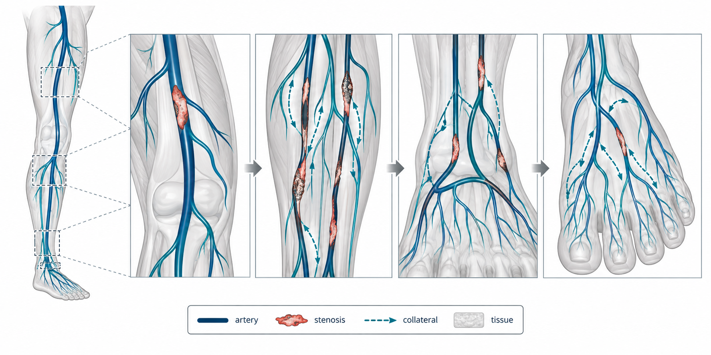

*原调研材料中的解剖示意图，用于说明近端、膝下及足部通路的连续性。图中的示意狭窄不代表真实患者数据。*

### 疾病负担与糖尿病的影响

PAD 是全球重要的慢性血管疾病。Fowkes 等与 Song 等的系统分析，以及中国人群的患病率研究，提示其负担随年龄、人口结构与危险因素分布而变化。不同年份研究使用的年龄范围、诊断标准及建模方法并不完全相同，不宜把它们简单拼接成同一条增长曲线。流行病学数据在本调研中的作用，是说明研究需求，而非推导某个患者的获益。[[1]](#ref-1)[[2]](#ref-2)[[3]](#ref-3)[[4]](#ref-4)[[5]](#ref-5)[[6]](#ref-6)[[7]](#ref-7)

糖尿病是 PAD 的重要危险因素，并与更复杂的远端病变、足部组织损伤及截肢风险相关。患者还常合并肾功能不全、冠心病等疾病，影响围术期风险和长期生存。因此，研究对象不能只用“是否糖尿病”二分，还应记录病程、肾功能、吸烟状态、既往重建、感染及创面情况。[[8]](#ref-8)[[9]](#ref-9)[[10]](#ref-10)[[42]](#ref-42)

### 多节段病变与动脉钙化

糖尿病相关下肢 PAD 常见长段、弥漫和膝下病变，也可能伴动脉中膜钙化。中膜钙化与粥样硬化斑块不是同一病理过程；前者可使动脉难以压缩、管壁顺应性降低，并干扰部分袖带压力测量。CTA 中明显钙化还可能产生伪影，增加残余管腔识别的难度。[[11]](#ref-11)[[12]](#ref-12)[[13]](#ref-13)[[14]](#ref-14)[[15]](#ref-15)

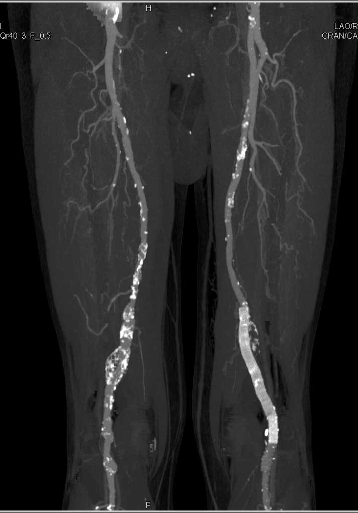

*原材料标注来源：CTisus 教学病例库，Case No. 8411。该图用于展示多节段病变与钙化的影像背景，不作为本课题的患者样本。*

对建模而言，应区分三个层面：影像上看见的管腔几何、血管壁及血液的力学性质、未被影像直接解析的远端微循环。仅凭 CTA 重建出的三维外观，通常不足以唯一确定流量分配和创面灌注。

## 血运重建策略的临床证据

### 旁路与腔内治疗：结果依赖患者与病变条件

BASIL、BEST-CLI 与 BASIL-2 分别回答了不同条件下初始重建策略的比较问题。研究人群、膝下病变比例、器械时代和终点定义存在差异，不能把一项研究的结果转写为适用于全部糖尿病下肢病变的固定优先级。[[16]](#ref-16)[[17]](#ref-17)[[18]](#ref-18)[[19]](#ref-19)[[111]](#ref-111)

| 研究 | 主要比较与适用范围 | 结果应如何理解 |
| --- | --- | --- |
| BASIL | 严重下肢缺血，旁路优先与球囊扩张优先 | 早期无截肢生存结果接近；长期及存活时间相关分析需要结合其分析条件解释 |
| BEST-CLI | 同时适合开放和腔内重建的 CLTI；按可用静脉条件分队列 | 有合适单段大隐静脉的队列中，旁路组“主要不良肢体事件或全因死亡”较少；无合适静脉队列未确立显著差异 |
| BASIL-2 | 需要膝下重建、可伴更近端腹股沟以下重建的 CLTI | 腔内优先组无截肢生存较好，差异主要由死亡事件驱动 |

BEST-CLI 的主要终点是**主要不良肢体事件（MALE）或全因死亡**。MALE 包含踝上截肢及重大肢体再次干预，与仅由大截肢和死亡定义的无截肢生存（amputation-free survival，AFS）不同。讨论试验结论时必须保留这一区别。[[19]](#ref-19)

这些结果支持分层选择：可用静脉、解剖复杂度、手术耐受、预期生存、患者目标和当地团队能力都需要考虑。某项研究中旁路或腔内策略的优势，不能被解释为某个单一解剖条件“决定”所有患者的最优术式；BEST-CLI 与 BASIL-2 的结果也不能脱离入组条件直接互相否定。[[19]](#ref-19)[[111]](#ref-111)

### 器械比较：通畅率与患者结局分别报告

BASIL-3 在需要股腘段腔内重建、可伴膝下重建的 CLTI 患者中，比较普通球囊±裸支架、药物涂层球囊±裸支架及药物洗脱支架。研究未显示两种药物器械策略相对普通球囊策略带来显著的主要临床终点获益；这不等同于所有器械在每个病灶、每项影像终点上都没有差异。[[21]](#ref-21)

膝下证据包括 ACHILLES、IDEAS、PADI、AcoArt II-BTK 及 LIFE-BTK。它们涉及不同器械、病变长度、纳入人群与随访时间，应分别阅读，尤其不能将某类相对短病变的结果外推到广泛钙化的长段闭塞。[[22]](#ref-22)[[23]](#ref-23)[[24]](#ref-24)[[25]](#ref-25)[[33]](#ref-33)

| 研究方向 | 原调研中的代表研究 | 对本课题的启示 |
| --- | --- | --- |
| 药物洗脱支架与球囊比较 | ACHILLES、PADI | 同时观察再狭窄、通畅、再次干预与肢体结局 |
| 药物涂层球囊与其他腔内器械 | IDEAS、AcoArt II-BTK | 保留具体器械及病变条件，避免合并为笼统的“药物器械效应” |
| 可吸收药物洗脱支架 | LIFE-BTK | 新器械结果为特定人群提供证据，不能自动代表长期保肢获益 |
| 初始股腘段器械策略 | BASIL-3 | 临床复合终点与影像通畅率应分别解释 |

其中，ACHILLES 随机纳入 **200 例**。该试验报告支架组一年再狭窄较少、通畅率较高，而死亡、重复重建及研究肢体截肢等结果未显示相应显著差异。其价值在于提醒：影像学改善并不必然转化为同等幅度的患者获益。[[22]](#ref-22)

### 多水平重建：流入道、流出道与分期

多水平病变涉及“先处理流入道还是流出道”“同期还是分期”“一条还是多条膝下血管”等不同问题。现有相关研究多为观察性队列，患者选择和技术可达性可能影响结果。Harward 等关于同期与分期重建的早期研究，以及后续杂交重建队列，可提供临床线索，但不能直接作为现代腔内治疗的统一排序规则。[[26]](#ref-26)[[40]](#ref-40)

流入道决定可提供的灌注压力，远端通路决定血流能否有效到达足部或创面。两者需要作为连续路径分析。WARRIORS 等研究提示，建立通向创面的连续血流与愈合结局相关；膝下解剖严重程度研究也说明远端病变是重要的预后背景。[[27]](#ref-27)[[28]](#ref-28)

“近端优先”可以是某些情况下合理的处理策略，但不是无需评估远端条件的普遍规则。同样，向更远端扩展操作可能增加技术难度、造影剂使用和并发症风险。研究模型应输出预期灌注变化及代价，让临床团队在具体条件下权衡。

### 无传统重建选择时的替代通路

对于经评估缺乏常规动脉重建选择的部分 CLTI 患者，经导管深静脉动脉化（percutaneous deep vein arterialization，pDVA）提供了另一种灌注途径。PROMISE I、PROMISE II、汇总 PROMISE 研究及 PROMISE-UK 报告了可行性与随访结果。[[29]](#ref-29)[[30]](#ref-30)[[31]](#ref-31)

这些结果支持继续研究特定 no-option 人群，但不能把单组研究的保肢信号解释为已证明优于所有其他管理方式。技术失败、再次干预、长期通畅和患者选择仍需关注。在本课题中，pDVA 提示候选方案可能包括改变供血路径，而不仅是扩大原有动脉管腔；这属于与常规动脉再通不同的建模问题。

## 如何定义与衡量“干预收益”

### 从技术成功到生活质量

“收益”必须对应明确的结局、比较对象和观察时间。术中残余狭窄减少、三个月血管通畅、一年创面愈合和两年无截肢生存并非同一目标。将它们合成一个没有清晰定义的“疗效分数”，会掩盖模型究竟预测了什么。[[32]](#ref-32)[[34]](#ref-34)[[35]](#ref-35)

| 层面 | 可记录的指标 | 解释边界 |
| --- | --- | --- |
| 技术与解剖 | 再通、残余狭窄、夹层及技术失败 | 描述手术完成情况，不能替代远期结局 |
| 血管持续开放 | 一期、辅助一期、二期通畅；再次干预 | 定义和随访检查方案需要一致 |
| 功能学与灌注 | 压差、流量、趾压、TBI、TcPO₂、SPP | 反映不同位置和尺度的供血状态 |
| 临床肢体结局 | 创面愈合时间、大截肢、MALE、AFS | 保留各自组成，避免将不同复合终点混用 |
| 生存与患者感受 | 总生存、疼痛、步行功能、VascuQoL-6 等 | 需要考虑全身共病与患者原有功能 |

一期通畅、辅助一期通畅和二期通畅需要按所采用的报告标准分别定义，明确是否发生维持通畅的干预、血栓形成后再通及检查确认。VascuQoL-6 等患者报告结局可补充血管影像未覆盖的功能与生活质量维度；其最小重要差值也应按验证人群和使用场景解释。[[32]](#ref-32)[[34]](#ref-34)[[35]](#ref-35)

### 解剖通畅与创面愈合之间的缺口

创面愈合受供血、感染、组织缺损、神经病变、减压和全身状态共同影响。Weaver 等比较 WIfI 与直接 angiosome 供血对糖尿病足创面愈合的预测能力，表明仅用“是否再通某条动脉”描述结局风险并不充分。AHA 灌注评估声明也强调，解剖检查需要与局部灌注评估结合。[[36]](#ref-36)[[37]](#ref-37)

这种关联不能反向解释为微循环异常使大血管重建没有意义。更合理的研究设计是同时测量重建前后的主干血流、足部灌注及创面变化，再分析哪些患者的功能改善能够转化为愈合，哪些患者需要其他治疗环节共同改善。

### 单血管与多血管再通：观察性结果的限度

Lavingia 等关于膝下单血管与多血管再通的回顾性比较，未发现主要肢体结局有显著差异。这对“每增加一条再通血管就增加固定收益”的假设提出质疑，但**未达统计学显著不能证明两种策略等效**，更不能证明所有患者都不需要额外通路。[[39]](#ref-39)

足弓状态、侧支、创面位置、基线缺血、病变可达性和术者选择均可能影响比较。额外再通的价值可能体现在不同区域的灌注、替代通路或长期通畅，也可能被额外风险抵消，需要在明确的研究设计中验证。[[27]](#ref-27)[[39]](#ref-39)[[63]](#ref-63)[[66]](#ref-66)

Nolan 等观察到既往同侧腔内干预失败与后续旁路不良结局相关。该关联提示策略规划与保护后续重建选择的重要性，但不能仅据此认定所有失败后的不良结局都由先前操作造成；病变严重程度和选择偏倚也可能参与。[[41]](#ref-41)

### 边际收益与病灶相互作用

为比较组合，可以将基线未处理的候选病灶集合记为 N，已处理集合记为 S，将特定时间点、特定目标的预期结果记为 U(S)。加入病灶 i 的边际收益定义为：

$$
\Delta_i(S)=U(S\cup\{i\})-U(S).
$$

这是拟采用的研究表述，不是已经验证的临床评分。U 可以首先取足部某出口流量、灌注压或达到预设功能目标的概率；若要改用创面愈合、保肢等临床终点，则需要额外的数据与验证。不同目标的量纲和临床含义不应混用。

两处病灶的交互项可写为：

$$
I_{ij}(S)=U(S\cup\{i,j\})-U(S\cup\{i\})-U(S\cup\{j\})+U(S).
$$

交互项可能为正、为负或接近零，取决于网络、流量和边界条件。因此，每完成一步虚拟或实际处理后，都应根据当前状态重新估计剩余病灶的边际收益，而不是沿用术前的一次性排序。

## 解剖、肢体威胁与供血区域分层

### 各体系回答不同问题

| 体系 | 主要描述 | 使用时需要保留的信息 |
| --- | --- | --- |
| SVS/ISCVS runoff score | 下游流出道病变负担 | 所用具体版本、节段及权重；通常分数越高表示流出道条件越差 |
| GLASS | 选定靶动脉路径上的腹股沟以下解剖复杂度 | 股腘与膝下病变、钙化及足部修饰信息 |
| TAP | 计划建立的靶动脉路径 | 起止范围及足部供血目标 |
| WIfI | 创面、缺血与足部感染所构成的肢体威胁 | 三个维度及临床分期，避免只保留一个总分 |
| Angiosome | 组织区域及其来源动脉的解剖供血关系 | 创面位置、直接或间接通路、足弓与侧支 |

这些体系互补，不能彼此替代。比如，解剖路径较简单不意味着创面负担轻；WIfI 威胁程度高也不意味着某一条特定血管一定是最优靶点。GLASS 与 WIfI 分别描述解剖复杂度和肢体威胁，联合使用有助于分层，但不是精确预测单病灶收益的计算器。[[32]](#ref-32)[[43]](#ref-43)[[44]](#ref-44)[[45]](#ref-45)[[48]](#ref-48)

### Runoff、GLASS 与 TAP

Runoff 评分将流出道病变程度进行加权，传统用途包括预后分层及通畅结果分析。通常分数越高表示流出道病变越重。不同重建部位与版本的评分规则可能不同，不能脱离原定义套用同一个阈值；例如主股旁路队列的结果不能直接当作所有膝下干预的判据。[[32]](#ref-32)[[38]](#ref-38)

2019 年全球血管指南（Global Vascular Guidelines，GVG）提出 GLASS，强调先确定 target artery path（TAP），再描述这条路径的病变复杂度及预期的 limb-based patency（LBP）。TAP 是规划路径的概念，不等于已证实能为每个患者带来最大愈合获益的唯一通路。[[44]](#ref-44)[[45]](#ref-45)

GLASS 在不同人群与治疗方式中的预测表现并不一致。Hicks 等的膝下腔内队列提出了外部验证方面的限制，提示分期不能替代局部功能学评估。Hardman 等 2014 年综述可用于了解当时的 PAD 分级，GLASS 则应追溯到 2019 年指南。[[47]](#ref-47)[[48]](#ref-48)

### WIfI：把创面和感染纳入研究

WIfI 分别对 Wound、Ischemia 和 foot Infection 进行分级，支持肢体威胁分层与重建获益评估。它不是仅凭某个分数就能判断“可以自行愈合”或“必须手术”的工具。缺血分级涉及踝压、趾压及经皮氧分压等指标；糖尿病或血管难以压缩时，需要特别关注趾压等局部测量。[[43]](#ref-43)[[44]](#ref-44)

Mayor、Weaver 等研究为 WIfI 与结局的关系提供了队列证据。对计算课题而言，应保留三个维度的原始信息，并明确测量时间，不能把术后变化混入术前预测特征，否则可能出现数据泄漏。[[36]](#ref-36)[[46]](#ref-46)

### Angiosome、足弓与侧支

直接血运重建（direct revascularization，DR）通常指恢复创面来源动脉的供血；间接血运重建（indirect revascularization，IR）通过其他动脉及侧支将血流送到创面。IR 并不等于“只处理近端”。不同研究对直接供血、侧支介导供血和创面跨区的定义不同，需要在比较前核对。[[49]](#ref-49)[[50]](#ref-50)[[51]](#ref-51)[[52]](#ref-52)[[53]](#ref-53)[[62]](#ref-62)

多项系统综述与 Meta 分析发现 DR 与更好的愈合或保肢结局相关，但纳入研究多为观察性资料，受到解剖可行性、病变严重程度、创面特征和定义差异影响。将合并结果表述为“已经证明所有患者必须 DR”超出了证据。[[54]](#ref-54)[[55]](#ref-55)[[56]](#ref-56)[[57]](#ref-57)[[58]](#ref-58)[[64]](#ref-64)

Špillerová 系列研究进一步讨论了腔内与旁路的差异、可行性和定义问题。旁路与腔内治疗都可能实现直接或间接供血，不能把术式本身等同于 DR 或 IR。某种策略的观察性优势，也不能简单归因于“旁路绕过所有侧支”。[[59]](#ref-59)[[60]](#ref-60)[[61]](#ref-61)[[62]](#ref-62)

足弓和侧支状态可能改变 DR 与 IR 的结局差异。Varela、Settembre 及 Glousman 等的研究提示，应把这些结构纳入灌注路径和预后分析。足弓不完整时直接供血可能更受重视，但仍需结合技术可达性和风险；不能仅根据足弓状态提出绝对治疗规则。[[51]](#ref-51)[[63]](#ref-63)[[65]](#ref-65)[[66]](#ref-66)

## 功能学与灌注评估

### 压力测量与外周压力指数

压力导丝、跨病变压差和回撤测量有助于区分不同节段的压力损失。外周血流储备分数（peripheral fractional flow reserve，pFFR）、静息压力比和其他功能指标已有研究，但血管节段、充血方式、阈值与结局关联尚未形成与冠脉完全相同的证据体系。冠脉常用的 FFR 阈值不能自动移作糖尿病下肢 PAD 的普遍干预标准。[[67]](#ref-67)[[68]](#ref-68)[[76]](#ref-76)[[77]](#ref-77)

Achim 等将术后 FFR 与趾压联系到长期预后；van Wely 等在膝下 PTA 中结合 OCT 与 FFR，说明形态和功能的联合评估值得继续研究。这些结果支持研究性应用和验证，不足以证明某个单一压力值能够决定全部临床处理。[[76]](#ref-76)[[77]](#ref-77)

### 串联狭窄的压降需要在同一流动状态下计算

跨狭窄压降可用含黏性与惯性项的简化形式帮助理解：

$$
\Delta P\approx aQ+bQ^2.
$$

这里 a、b 与几何、流动条件及所用模型相关。处理一处病灶会改变流量及下游压力，因此不能把各病灶在不同流量条件下“单独测得的贡献”直接相加。需要区分：在同一次测量、同一状态下，连续节段的压力差仍满足端点压力的加减关系。

偏心程度、狭窄长度、病灶间距及压力恢复也会影响结果。van de Velde 等关于串联狭窄形态的计算研究，为“同样狭窄率不一定具有同样功能影响”提供了方法学证据；其适用范围仍需与模型和验证条件一起理解。[[70]](#ref-70)

### ABI、TBI 与局部组织灌注

ABI 是重要的基础检查，但糖尿病和慢性肾病患者可能出现胫动脉难以压缩，使 ABI 假性升高；部分 CLTI 患者的 ABI 也不能充分反映足部缺血。2024 ACC/AHA 多学科指南明确支持在相应情况下结合趾压/TBI 及波形、TcPO₂ 或皮肤灌注压（SPP）评估。[[37]](#ref-37)[[75]](#ref-75)[[110]](#ref-110)

| 检查 | 可提供的信息 | 主要局限或注意点 |
| --- | --- | --- |
| ABI | 踝部与肱动脉压力比 | 钙化及动脉难以压缩可能影响解释，不能独立排除所有 CLTI |
| 趾压 / TBI | 趾端压力及其与肱动脉压力的关系 | 测量环境、足趾条件及波形质量需要记录 |
| TcPO₂ | 局部组织氧合的间接信息 | 受探头位置、温度、局部组织及全身状态影响 |
| SPP / PVR | 微循环灌注或容积脉搏相关信息 | 不同仪器、位置与协议的结果不宜直接互换 |
| DUS / PSV / PSVr | 流速波形、局部狭窄和术后监测信息 | 测量角度、参考节段和血管区域会影响阈值 |
| 灌注影像 / LSCI | 区域灌注与皮肤微循环变化 | 不一定直接对应深部组织供血或长期愈合 |

Aparicio、Nützel、Aronsson 等工作分别提供了 TBI、前足 PVR 和皮肤灌注搏动的研究线索。其诊断或治疗反应结果需要在各自人群和方法中理解，不能由单篇研究推导某种检查在所有糖尿病患者中都优于其他检查。[[78]](#ref-78)[[79]](#ref-79)[[80]](#ref-80)

本课题应避免把单次 ABI 当作唯一真值，也不应把趾压、TcPO₂ 或 SPP 的某个文献切点视作保证愈合的硬界限。更可行的做法是预先规定检查协议、保留连续数值，采用多个互补指标校准与验证，并分析测量误差。

### 在体 CFD 验证与诊断统计的解释

van de Velde 等 2026 年的前瞻性单中心可行性研究纳入 15 名多节段股腘病变患者，比较 CTA/DUS 驱动 CFD 与有创测压，FFR 验证仅在其中 9 名患者中完成。它属于小样本概念验证，不能称为已建立的临床筛选规则。[[69]](#ref-69)

研究中 FFR 分类的特异度点估计可达 100%，但置信区间较宽。**特异度是对参照阴性对象的正确识别比例，不等于“模型判断阳性就一定需要治疗”**；同样，有限的灵敏度意味着阴性预测可能漏掉有功能意义的病变，不能写成“预测阴性即可放心不治”。预测值还取决于患病率、参考标准与样本构成。[[69]](#ref-69)

超声测速验证和入口条件敏感性研究进一步提示，输入流速测量方法会影响预测流场及 WSS。它们为建模流程提供验证思路，但不能将不同论文的结果合并为一个“临床准确率”。[[71]](#ref-71)[[72]](#ref-72)[[73]](#ref-73)[[74]](#ref-74)

## 计算模型与人工智能方法

### 0D：集总参数网络

0D 模型将血管及末端循环表示为阻力、顺应性、惯性等元件，计算节点压力和网络流量。它适合用于整体血流分配、边界条件耦合和大量候选方案的初筛。模型中若加入狭窄的非线性压降项，仍需重新求解干预后的网络状态，不能简单叠加预先计算的固定收益。[[81]](#ref-81)[[82]](#ref-82)[[83]](#ref-83)[[84]](#ref-84)

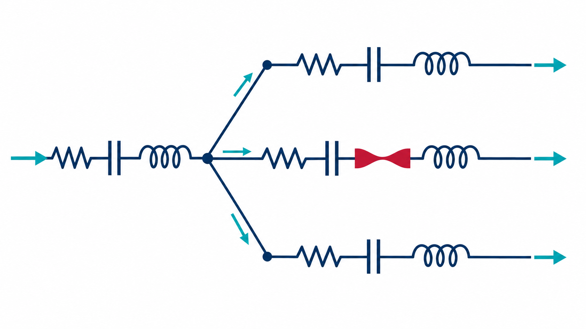

*原调研中的电路类比图。电路元件用于描述血管和末端循环的简化动力学，并非真实血管内部结构。*

其局限是不能解析局部三维流动或直接获得可信的壁面剪切应力。运行速度取决于网络规模、方程形式与求解实现，不能将所有 0D 模型统称为“毫秒级且足够准确”。

### 1D：中心线网络与脉搏波传播

1D 模型沿血管轴向描述截面积、平均速度、流量和压力，并通过壁面关系及分叉条件连接网络。它能够表达脉搏波传播与反射，相较完整 3D 模型通常计算代价较低，适合在多分支网络中比较干预情景。[[81]](#ref-81)[[82]](#ref-82)[[83]](#ref-83)[[85]](#ref-85)[[86]](#ref-86)

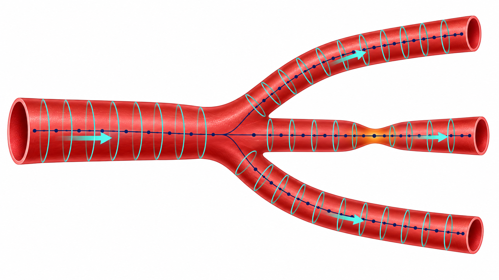

*原调研中的 1D 建模示意图。局部截面与轴向离散用于解释一维近似，不代表其能够解析所有截面内流动细节。*

Jin 与 Alastruey 比较了狭窄和动脉瘤场景中的 1D 模型、3D 仿真及体外测量。此类工作为选用降阶模型提供依据，但不能证明任意糖尿病下肢网络均有相同精度。应根据压力、平均流量、波形、局部压差等不同目标分别验证。[[85]](#ref-85)

### 3D CFD：局部流动与关键方案复核

3D CFD 基于重建几何和边界条件求解流场，可分析局部压降、速度分布、回流及 WSS。其优势在于空间细节，代价包括分割、网格、参数设定、收敛与后处理。计算时间随稳态或脉动、几何规模、网格、模型和硬件变化，不能固定写成“一次十分钟”或“一次数天”。[[69]](#ref-69)[[70]](#ref-70)[[71]](#ref-71)[[72]](#ref-72)[[73]](#ref-73)

Corti 等将组织损伤与血流动力学纳入患者特异多尺度模型，体现了从即刻血流向再狭窄机制延伸的方向。单纯扩大管腔的流体模型，无法自动预测夹层、弹性回缩、支架作用或药物器械对长期再狭窄的影响。[[87]](#ref-87)

对本课题，比较实际的策略是先用 0D/1D 筛查大规模情景，再对关键方案或排序不稳定的方案进行 3D 复核。3D 仿真也有模型误差，不能未经实测验证就称为真实“标准答案”。

### 神经代理、神经算子与物理约束

神经代理通过学习仿真或测量数据，近似输入与输出之间的关系。FNO、DeepONet 属于算子学习代表方法；PINN 是利用方程残差、边界条件等训练网络的框架，不能简单与前两者并列为同一类“通用算子”。是否具备跨几何、跨边界条件泛化能力，需要单独设计测试。[[90]](#ref-90)[[91]](#ref-91)[[92]](#ref-92)

| 方法层 | 可承担的任务 | 必须验证的内容 |
| --- | --- | --- |
| 0D/1D 物理模型 | 网络状态、压力流量及候选情景生成 | 方程假设、边界条件与实测一致性 |
| 树模型 / MLP 等代理 | 近似特定患者或参数空间的物理求解器 | 训练范围、插值与外推误差 |
| 神经算子 / 几何深度学习 | 跨几何或不同采样上的场预测 | 未见患者、拓扑、狭窄程度和波形下的误差 |
| PINN / 物理约束学习 | 利用守恒与边界信息辅助学习或反演 | 数据误差、物理残差、边界满足程度及可辨识性 |
| 多尺度模型 | 即刻血流与壁面损伤、血栓等机制关联 | 各尺度参数及临床终点的独立验证 |

股动脉再狭窄风险区识别与个体化血流实时代理等研究，可提供数据生成和快速预测的思路。合成数据上的良好表现，说明模型在所定义分布中的近似能力；它不等于已经学到真实患者的因果治疗效应或长期愈合规律。[[88]](#ref-88)[[103]](#ref-103)

### HarVI：最接近的下肢虚拟干预实例

HarVI 将患者特异几何、1D 血流计算、边界条件优化和机器学习代理结合，用于快速查询虚拟干预后的状态。2026 年下肢研究回顾性分析 7 名 CLTI 患者的股浅动脉病变，并用术后双功超声的峰值流速（PSV）评估预测。[[89]](#ref-89)

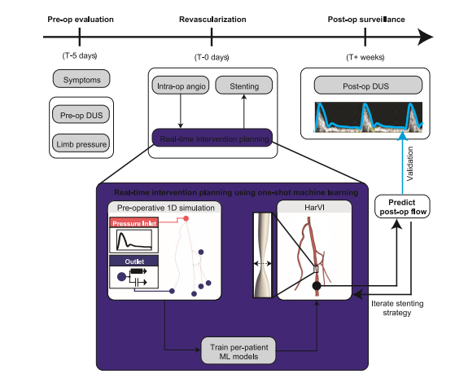

*原调研引用的 HarVI 下肢工作流程图，来源：Tanade 等，2026，文献 [89]。*

作者报告训练后平均单方案查询约 34 ms。这个数字指代理查询，不是影像采集、重建、参数标定与训练全部完成的时间。研究支持小样本中的术后血流预测可行性；相关性也不等于逐患者误差足够小。[[89]](#ref-89)

其远端简化、样本量及回顾性设计限制了外推。该研究尚未证明可对髂股—股腘—膝下—足弓所有病灶进行全面组合优化，也未证明模型推荐提高了愈合或保肢结局。本课题可借鉴流程，但需要显式展开拟比较的远端分支，并补充对应验证。[[89]](#ref-89)

### 从中心线预测壁面场：RBF Decoder

《From Centerlines to Hemodynamics: Anisotropic RBF Decoders for Coronary Arteries》用中心线几何、半径与入口流量等信息，经 Transformer 编码和各向异性 RBF 解码，在壁面查询位置预测压力与 WSS。论文包含合成单血管数据，以及基于 ImageCAS 几何、通过狭窄和流量变化构建的多血管数据。[[113]](#ref-113)

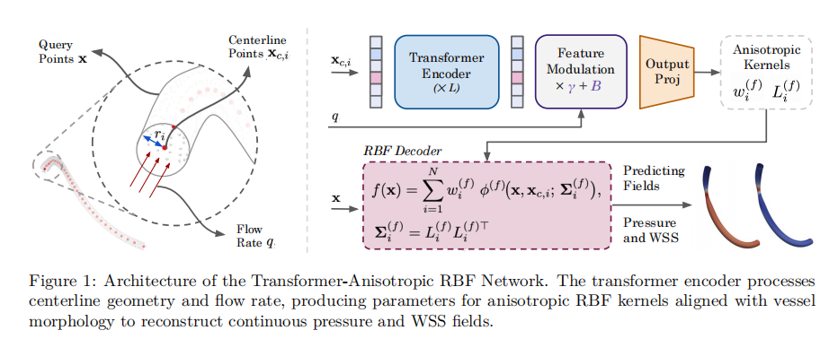

*原调研引用的网络图，来源：Bafghi、Thakur 与 Raissi，arXiv:2605.27578，文献 [113]。*

它启发了“紧凑几何输入—连续位置查询”的代理设计。连续查询不意味着任意分辨率下都保持相同误差，也不意味着总查询成本与点数无关。论文中的稳态 CFD 标签和基准优势，不能直接证明脉动、柔性壁、严重钙化或真实下肢多病灶中的临床有效性。[[113]](#ref-113)

### Graph Transformer 与几何泛化

《Graph Deep Learning for Intracranial Aneurysm Blood Flow Simulation and Risk Assessment》结合图 Transformer 与自回归预测，研究脉动流场和相关壁面指标。它提供了复杂几何上全场代理的实例，但研究对象是颅内动脉瘤，不能直接作为下肢 PAD 的验证证据。[[114]](#ref-114)

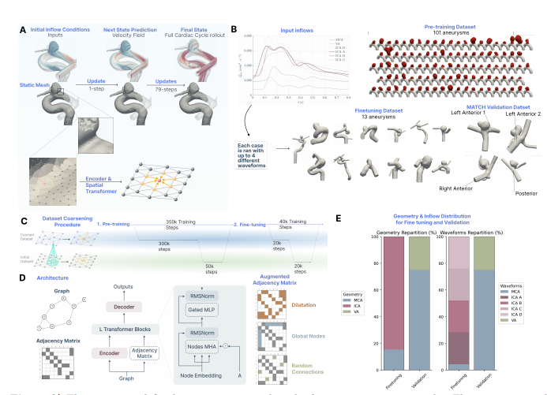

*原调研引用的图示，来源：Garnier 等，arXiv:2512.09013，文献 [114]。*

《Learning Hemodynamic Scalar Fields on Coronary Artery Meshes》比较不同几何学习架构，为选择模型提供基准。不同架构的表现依赖数据分布、任务和测试条件，不能将个别基准结果概括为某类模型在全部复杂拓扑上有效。评价时应报告明确的压力、速度、WSS 误差及空间位置，并关注误差是否改变病灶排序。[[116]](#ref-116)

### 可借鉴的多尺度与数据集工作

原调研还关注了林晨森等研究者参与的血液力学、数据集和物理约束方法。文献 [97] 当前版本于 2026 年 9 月 30 日更新，本次整理按该版本补记，不能将其版本信息当作归档当日已知结果。这些工作的共同价值是提供研究工具，而非已经验证下肢干预决策。

| 研究线索 | 与本课题的联系 | 迁移时的边界 |
| --- | --- | --- |
| 正常及糖尿病血液的多尺度血栓模型 | 考察血细胞、血小板和凝血过程 | 机制模型结果不能直接替代个体临床血栓风险 |
| Aneumo 数据集 | 真实几何、形变及 CFD 配对的数据生成 | 数据集版本与数量需区分，动脉瘤分布不同于下肢病变 |
| 无散度神经算子 | 探索不可压缩条件的结构约束 | 满足散度约束并不保证所有动力学与边界正确 |
| 复杂壁面 DPD 边界 | 为微观或多尺度流动建模提供方法 | 与连续介质网络模型的耦合仍需设计 |
| 跨尺度算子学习 | 学习不同尺度过程的映射 | 气泡等对象的成功不能直接外推到血管 |

相关文献保留在文末，便于继续追溯。不同版本 Aneumo 的几何数、形变数和 CFD 样本数不宜拼接为一个统一规模；科研项目介绍也不能作为方法已获得临床验证的证据。[[95]](#ref-95)[[96]](#ref-96)[[97]](#ref-97)[[98]](#ref-98)[[99]](#ref-99)[[100]](#ref-100)[[102]](#ref-102)

### Murray 律与分支流量先验

理想化 Murray 律常写为母支与子支半径三次方关系，但其成立依赖特定优化和流动假设。冠脉研究已讨论实际分支关系对经典指数的偏离；这仍是冠脉证据，不能证明糖尿病下肢动脉树必然存在同样偏离。[[101]](#ref-101)

本课题可将分叉指数或相关关系作为待检验的先验：比较不同分支、钙化程度和病变状态，分析 CTA 分辨率、分割误差和近狭窄测量位置的影响。即便半径关系拟合良好，也不能仅由几何关系确定患者特异出口阻力。

## 拟开展的技术路线

### 从临床问题定义模型输入与输出

初期任务宜限定为：在已核对的患者血管网络上，预测候选修复组合引起的压力与流量变化，并判断这些变化对模型假设是否敏感。在功能学预测得到验证后，再研究与创面愈合等临床结局的关联。

| 环节 | 主要输入 | 主要输出与质量控制 |
| --- | --- | --- |
| CTA 处理 | 影像、分辨率、扫描范围及钙化情况 | 管腔分割、中心线、拓扑和不确定区域 |
| 血管建图 | 人工核对后的分支与病灶 | 固定网络、病灶范围、出口及供血目标 |
| 参数标定 | 血压、DUS、趾压或其他可用检查 | 边界条件及其不确定范围 |
| 虚拟干预 | 病灶集合、修复程度及技术约束 | 合理的修复几何或参数情景 |
| 物理计算与代理 | 网络、参数及情景 | 压力、流量、波形和误差估计 |
| 组合比较 | 输出目标、风险及资源约束 | 候选方案、边际收益与排序稳定性 |
| 验证 | 独立测量、术后随访和临床记录 | 功能学误差、推荐变化及临床关联 |

### CTA 分割、中心线与血管建图

分割阶段可用 nnU-Net 作为有充分应用基础的自配置基线，并按数据条件比较 3D U-Net、Swin-UNETR 等。MedSAM 类方法是否适合长范围、细小远端血管，仍需结合交互方式、训练数据及实际结果评估。VMTK 可用于中心线和计算域处理；它不会自动消除闭塞处的拓扑歧义。[[93]](#ref-93)[[94]](#ref-94)

原材料还讨论了 LEAS-Net、SeqSeg 和 DeepVesselNet。它们分别提供定位—精分割、局部逐段追踪、血管与中心线联合学习等思路，但原始应用场景和数据并不都覆盖病变下肢 CTA，应作为候选方法线索，而非已经确立的本课题最佳方案。

二维目标检测可以帮助定位和分级，不能单独提供 CFD 所需的连续三维管腔。它可作为候选病灶提示或辅助标注模块，后续仍需获得三维中心线、截面、病变长度与分叉关系。[[117]](#ref-117)

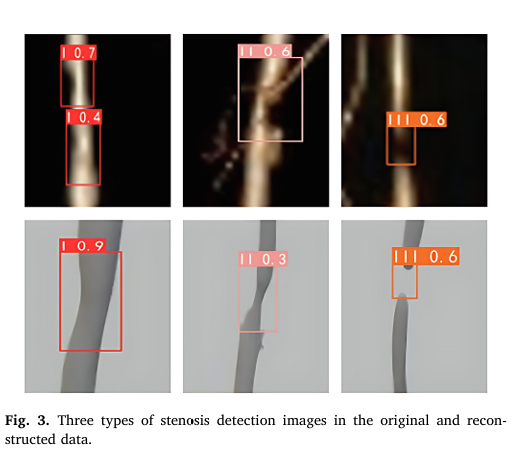

*原材料引用 Wu 等《A novel approach for diabetic foot diagnosis: Deep learning-based detection of lower extremity arterial stenosis》的检测图，来源文献 [117]。该图展示局部检测，不代表三维几何已完成重建。*

质量控制不能只用 Dice。还应检查细分支召回、中心线连续性、分叉连接、最窄截面、闭塞段起止及钙化附近误差。对于闭塞后不可见的管腔，不能把算法插补的路径当作直接观察，应明确标记并做敏感性分析。

### 固定血管图与候选病灶

将分叉和端点作为节点、血管段作为边，记录长度、截面积或半径沿程变化、病灶位置、分支方向及可用的壁面参数。人工复核后锁定一版基线拓扑，保存影像与中心线坐标对应，确保每个候选点能够回溯。

候选干预单元可以是一段病变或临床可实施的连续修复范围，不必等同于单个体素、网格点或图节点。对跨分叉、连续长段及完全闭塞，应由具体操作约束决定如何组合，避免生成解剖上可计算、临床上无法完成的方案。

初始比较可覆盖基线、单病灶修复、必要的路径组合及少量临床备选方案，再逐步扩大范围。若二元候选病灶数为 n，全部子集有 2ⁿ 个；当加入不同修复程度、器械或分期后，搜索规模还会增加，需要与临床团队先限定候选空间。

### 反事实标签：仿真提供一种途径

同一患者通常只能观察到实际接受方案的结局，其他方案的反事实结局不能同时直接观测。物理仿真可以在相同基线条件下改变病灶状态，构建成对的虚拟干预情景，便于学习组合差异。

但仿真不是“唯一干净标签来源”，也不自动消除混杂或模型错误。随机试验、前瞻登记、因果推断和体外实验同样能为效应评估提供信息。仿真给出的首先是**在所设方程、边界条件和干预假设下的模型效应**，其与真实治疗效应的接近程度需要验证。

只有明确结构、干预语义和不变机制之后，才可讨论将其表示为结构因果模型。不能仅因能改变半径并再次求解，就把输出称为已识别的临床 do-效应。

### 边界条件标定与可辨识性

同一套 CTA 几何，在不同入口波形、出口阻力与顺应性下可能产生不同的流量分配。血压、DUS 波形及其他可用检查应尽量来自接近的生理状态，并记录测量位置、心率、用药或其他相关条件。

校准时明确哪些参数来自实测、哪些来自文献先验、哪些通过优化反演。观测稀疏时，多组参数可能同样拟合现有数据；因此应检验可辨识性，报告不确定区间或多组可行参数，而不是只输出一个看似精确的最优值。

若要比较胫前、胫后和腓动脉等不同路径，就需要显式表示与问题相关的远端分支及足部连接。将整个膝下循环合并为单一阻力的模型，无法直接解释具体远端路径的差异。微循环可先用参数化末端模型表达，但其假设需要单独校验。

### 虚拟修复与几何更新

虚拟干预应包含修复范围和残余狭窄程度，并允许模拟不完全扩张。不要把所有治疗统一设为恢复理想正常管径；真实操作可能伴弹性回缩、夹层、侧支改变及远端阻力变化，这些因素至少应列入敏感性分析。

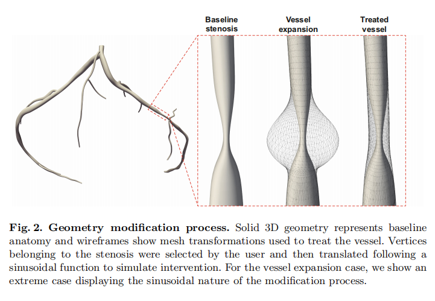

*原调研引用的冠脉 HarVI 几何修改示意，来源文献 [112]。冠脉示例用于解释交互方式，不表示其参数可直接用于下肢。*

通过移动局部表面顶点或修改中心线半径，可以生成候选几何；但即使不重新划分网格，也必须检查单元质量、分叉畸变及自相交。几何更新规则需要与预期术式对应，并保留修改前后的版本以便复核。

### 离线准备与在线查询

离线阶段完成影像重建、人工核对、参数校准、情景采样、物理求解及代理训练。在线阶段接收候选病灶、修复范围与程度，快速返回预测结果、适用范围和误差提示。二者的耗时应分别报告。

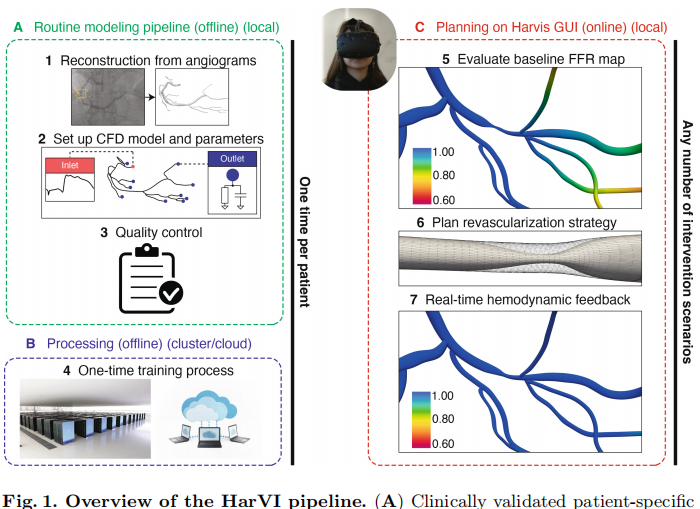

*原调研引用的冠脉 HarVI 流程，来源文献 [112]。这里借鉴其工作流，功能指标及判据需要针对下肢重新验证。*

训练情景应覆盖基线、单点、多点、不同修复程度及合理边界条件变化，并保留独立测试集。采样数不能直接照搬某篇论文中的收敛结果；需要根据当前网络复杂度、输出目标和误差曲线确定。

代理输出至少包括目标出口的压力或流量，以及关键节段波形。若临床问题只需要网络级血流分配，不必为了输出更多物理量而强行预测 WSS；若研究问题涉及局部再狭窄机制，则需要对应的空间分辨率和验证。

### 组合优化与顺序更新

建议先采用可检查的基线策略：按临床经验选择、按解剖狭窄程度选择、按单步模拟边际收益选择，以及在小规模候选集中穷举。只有明确这些方法的差异后，再考虑束搜索、贝叶斯优化或其他复杂方法。

优化目标应同时说明收益、风险和约束。可比较足部供血改善、达到功能目标的概率、需处理病灶数及资源代价。权重未获得依据时，可展示多个互不支配的候选方案，而不是把主观权重包装成唯一最优解。

每次实际干预后，利用新测量更新边界条件和剩余几何，再计算后续收益。只有这种状态更新，才能区分“一次性选一个病灶集合”与“随治疗过程调整顺序”两个任务。最终状态相同也不保证过程中的风险、耗时和可实施性相同。

### 肺动脉多狭窄研究的启发与边界

《A Probabilistic Neural Twin for Treatment Planning in Peripheral Pulmonary Artery Stenosis》演示了“3D 标定—0D 降阶—MLP 代理—概率化方案比较”的路线。这里的 peripheral pulmonary artery 指**外周肺动脉**，并非下肢外周动脉。这一区别限制了其结果向糖尿病下肢病变直接外推。[[115]](#ref-115)

该研究演示了用高成本模型支持降阶与快速概率查询的流程，并考虑修复程度不确定性。其单一病变网络上的演示，不能证明已完成糖尿病下肢临床验证。值得借鉴的是不确定性和离线—在线组织方式，而非直接搬用原病例中的网络参数、样本数与速度。[[115]](#ref-115)

### 交互界面应展示哪些信息

界面应将候选病灶及修复范围映射回影像与血管图，展示基线与修复后的压力、流量变化，并说明当前参数及预测范围。用户需要能查看某个方案改善了哪些区域、是否降低其他通路供血，以及结果对出口条件有多敏感。

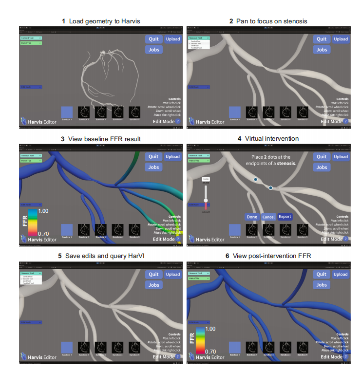

*原调研引用的冠脉 HarVI 交互示例，来源文献 [112]。图中的冠脉 FFR 展示方式不能直接作为下肢干预阈值。*

不宜只用红绿配色输出“治或不治”。模型超出训练范围、几何存在不确定性或不同参数下排序发生变化时，应明确展示原因，并保留方案修改和计算版本，支持人工复核。

## 验证设计与研究局限

### 将几何、物理预测和临床价值分开验证

| 验证层 | 建议设计 | 避免的误区 |
| --- | --- | --- |
| 图像与几何 | 独立人工复核、中心线与管径误差、拓扑检查 | 仅用总体 Dice 掩盖关键狭窄或断支错误 |
| 物理求解 | 网格/时间步检查、守恒、合理边界条件、体外或实测对照 | 仅凭数值收敛就认定模型真实 |
| 代理近似 | 按患者划分，测试未见拓扑、修复组合和波形 | 将同一患者派生样本随机拆分后当作跨患者泛化 |
| 功能学预测 | 与独立 DUS、压力或灌注检查比较 | 用参与标定的观测再次宣称独立验证 |
| 临床关联 | 预先规定愈合、MALE、AFS、再次干预等终点 | 将流量上升直接换算成已证实的保肢收益 |
| 决策价值 | 先静默验证，再评估推荐对方案和结局的影响 | 模型运行更快就等于患者获益更高 |

代理模型需要同时通过物理近似误差和临床预测误差两类检验。前者说明它能否复现指定求解器，后者说明求解器及其参数是否接近真实患者。两者不能互相替代。

### 指标、数据划分与不确定性

压力和流量应报告绝对误差、相对误差及临床相关范围中的偏差；波形比较关注幅值、时序和形态，必要时使用一致性分析。相关系数可以补充，但较高相关并不代表误差小、无系统偏差或分类可靠。

病灶排序还需要独立指标：推荐顺序是否改变、最优候选是否被遗漏、不同测量和参数条件下排序是否稳定。平均场误差较低，仍可能在几个相近方案间产生错误的优先级。

按患者和中心划分数据，保存影像、病灶、手术、随访及 CFD 派生样本之间的层级关系。术后变量只用于明确的更新任务，不能泄漏到术前预测。样本量、缺失数据、随访丢失和竞争死亡风险也需在设计阶段考虑。

不确定性可来自分割、管径、流量测量、出口参数、修复效果和代理本身。可在合理范围内重复计算并观察预测区间和排序变化。若候选方案对这些假设高度敏感，当前证据应支持“需要补充测量”，而非输出过度确定的建议。

### 指南提供框架，模型补充量化

GVG 2019、ESC 2024 与 ACC/AHA 2024 为 PAD/CLTI 的评估和管理提供不同范围的框架。GVG 强调患者风险、肢体威胁和解剖条件；后两者还覆盖危险因素管理、药物、功能和多学科照护。[[44]](#ref-44)[[45]](#ref-45)[[104]](#ref-104)[[110]](#ref-110)

ESVS 2024 的相关指南主要面向无症状下肢 PAD 和间歇性跛行，不能将其标题改写成独立的 CLTI 指南。ADA 标准及中国糖尿病足指南提供糖尿病管理与足部照护背景；它们也不是自动生成逐病灶干预顺序的工具。[[105]](#ref-105)[[106]](#ref-106)[[107]](#ref-107)[[108]](#ref-108)[[109]](#ref-109)

计算模型的定位，是在这些框架内补充患者特异的情景比较。其训练目标、评价指标和解释方式需要与临床问题对应，不应在缺乏证据时生成超出指南和已验证场景的确定性规则。

### 尚未解决的问题

目前的核心缺口，是缺少同时关联术前几何、术中或术后功能学、具体修复操作与长期临床结局的数据。大规模 CFD 数据可以改善代理训练，却不能替代临床结局数据。

其次，多病灶模型中的远端循环、足弓、侧支、钙化壁面及修复后变化仍需要合理的表示与校准。对于每个因素，应明确其进入模型是为了回答哪个问题，避免增加无法由现有数据识别的参数。

最后，预测正确与推荐有效之间还有一层证据要求。模型即便较准确地预测了术后 PSV 或压差，也不自动证明按其推荐顺序操作能改善愈合或减少截肢。临床价值需要在事先规定的验证与比较中逐步建立。

本调研保留的实施方向是：建立可追溯的患者血管图，以实测信息约束边界条件，通过多保真计算和快速代理比较合理干预情景，再分层验证几何、功能预测及临床关联。它是一条待验证的研究路线，现阶段适合输出有依据、可复核的候选方案及不确定性。

## 参考文献与延伸阅读

参考文献沿用原调研编号，以便回溯；[110]—[117] 为本次整理补充的出处。已重点核对主要试验终点、关键样本量与计算方法的研究对象，并更正明显书目错误。图示保留原材料来源，第三方图示版权归原作者。其余条目保留作延伸阅读，不表示已逐篇完成全文和全部效应量复核。预印本及项目介绍与同行评议的临床证据分开理解。

**[1]** Fowkes FGR, Rudan D, Rudan I, Aboyans V, et al. Comparison of global estimates of prevalence and risk factors for peripheral artery disease in 2000 and 2010: a systematic review and analysis. Lancet. 2013;382:1329–1340. [原文 / 题录](https://doi.org/10.1016/S0140-6736(13)61249-0)

**[2]** Song P, Rudan D, Zhu Y, Fowkes FJI, Rahimi K, Fowkes FGR, Rudan I. Global, regional, and national prevalence and risk factors for peripheral artery disease in 2015: an updated systematic review and analysis. The Lancet Global Health. 2019;7:e1020–e1030. [原文 / 题录](https://doi.org/10.1016/S2214-109X(19)30255-4)

**[3]** Song P, Rudan D, Wang M, Chang X, Rudan I. National and subnational estimation of the prevalence of peripheral artery disease (PAD) in China: a systematic review and meta-analysis. Journal of Global Health. 2019;9:010601. [原文 / 题录](https://doi.org/10.7189/jogh.09.010601)

**[4]** Criqui MH, Aboyans V. Epidemiology of peripheral artery disease. Circulation Research. 2015;116:1509–1526. [原文 / 题录](https://doi.org/10.1161/CIRCRESAHA.116.303849)

**[5]** Sampson UK, Fowkes FG, McDermott MM, Criqui MH, Aboyans V, Norman PE, et al. Global and regional burden of death and disability from peripheral artery disease: 21 world regions, 1990 to 2010. Global Heart. 2014;9:145–158.e21. [原文 / 题录](https://doi.org/10.1016/j.gheart.2013.12.008)

**[6]** Zhou J, Liu X, Shan S, He T, Zhu X, Zhu L, et al. Global, regional, and national prevalence of peripheral arterial disease in 2023: an updated systematic review and modelling study. The Lancet Regional Health – Europe. 2026;103983. [原文 / 题录](https://pubmed.ncbi.nlm.nih.gov/42480579/)

**[7]** Zhou J, Shan S, Shen G, Tan B, Ying J, Rudan I, Song P. National, regional and provincial prevalence of peripheral artery disease in Chinese adults in 2023: an updated systematic review and modelling study. Journal of Global Health. 2026;16:04155. [原文 / 题录](https://doi.org/10.7189/jogh.16.04155)

**[8]** Abu Dabrh AM, Steffen MW, Undavalli C, Asi N, Wang Z, Elamin MB, Conte MS, Murad MH. The natural history of untreated severe or critical limb ischemia. Journal of Vascular Surgery. 2015;62:1642–1651.e3. [原文 / 题录](https://doi.org/10.1016/j.jvs.2015.07.065)

**[9]** Barnes JA, Eid MA, Creager MA, Goodney PP. Epidemiology and risk of amputation in patients with diabetes mellitus and peripheral artery disease. Arteriosclerosis, Thrombosis, and Vascular Biology. 2020;40:1808–1817. [原文 / 题录](https://doi.org/10.1161/ATVBAHA.120.314595)

**[10]** Singh MV, Dokun AO. Diabetes mellitus in peripheral artery disease: beyond a risk factor. Frontiers in Cardiovascular Medicine. 2023;10:1148040. [原文 / 题录](https://doi.org/10.3389/fcvm.2023.1148040)

**[11]** Lehto S, Niskanen L, Suhonen M, Rönnemaa T, Laakso M. Medial artery calcification: a neglected harbinger of cardiovascular complications in non-insulin-dependent diabetes mellitus. Arteriosclerosis, Thrombosis, and Vascular Biology. 1996;16:978–983. [原文 / 题录](https://doi.org/10.1161/01.ATV.16.8.978)

**[12]** Lanzer P, Boehm M, Sorribas V, Thiriet M, Janzen J, Zeller T, St Hilaire C, Shanahan C. Medial vascular calcification revisited: review and perspectives. European Heart Journal. 2014;35:1515– 1525. [原文 / 题录](https://doi.org/10.1093/eurheartj/ehu163)

**[13]** Lanzer P, Hannan FM, Lanzer JD, Janzen J, Raggi P, Furniss D, et al. Medial arterial calcification: JACC state-of-the-art review. Journal of the American College of Cardiology. 2021;78:1145–1165. [原文 / 题录](https://doi.org/10.1016/j.jacc.2021.06.049)

**[14]** Lanzer P, Schurgers L, Twarda-Clapa A, Ferraresi R, Hui H, Kamenskiy A, et al. Medial arterial calcification in ageing and disease: current evidence and knowledge gaps. European Heart Journal. 2025;46:4876–4900. [原文 / 题录](https://doi.org/10.1093/eurheartj/ehaf341)

**[15]** Forsythe RO, Jones KG, Hinchliffe RJ. Distal bypasses in patients with diabetes and infrapopliteal disease: technical considerations to achieve success. International Journal of Lower Extremity Wounds. 2014;13(4):347–362. [原文 / 题录](https://doi.org/10.1177/1534734614546951)

**[16]** Adam DJ, Beard JD, Cleveland T, Bell J, Bradbury AW, Forbes JF, et al. Bypass versus angioplasty in severe ischaemia of the leg (BASIL): multicentre, randomised controlled trial. Lancet. 2005;366:1925–1934. [原文 / 题录](https://doi.org/10.1016/S0140-6736(05)67704-5)

**[17]** Bradbury AW, Adam DJ, Bell J, Forbes JF, Fowkes FG, Gillespie I, Ruckley CV, Raab GM, BASIL trial participants. Bypass versus Angioplasty in Severe Ischaemia of the Leg (BASIL) trial: an intention-to-treat analysis of amputation-free and overall survival. Journal of Vascular Surgery. 2010;51:5S–17S. [原文 / 题录](https://doi.org/10.1016/j.jvs.2010.01.073)

**[18]** Menard MT, Farber A, Assmann SF, Choudhry NK, Conte MS, Creager MA, et al. Design and rationale of the Best Endovascular Versus Best Surgical Therapy for Patients With Critical Limb Ischemia (BEST-CLI) trial. Journal of the American Heart Association. 2016;5:e003219. [原文 / 题录](https://doi.org/10.1161/JAHA.116.003219)

**[19]** Farber A, Menard MT, Conte MS, Kaufman JA, Powell RJ, Choudhry NK, et al. Surgery or endovascular therapy for chronic limb-threatening ischemia (BEST-CLI). New England Journal of Medicine. 2022;387:2305–2316. [原文 / 题录](https://doi.org/10.1056/NEJMoa2207899)

**[20]** Powell RJ, Farber A, Doros G, Chew D, Conte MS, Dake MD, et al. The incidence and consequences of endovascular technical failure in patients with chronic limb-threatening ischemia: results from the BEST-CLI trial. Journal of Vascular and Interventional Radiology. 2025;36:950–959. [原文 / 题录](https://doi.org/10.1016/j.jvir.2025.02.020)

**[21]** Bradbury AW, Hall JA, Popplewell MA, Meecham L, Bate GR, Kelly L, Deeks JJ, Moakes CA, BASIL-3 Investigators. Plain versus drug balloon and stenting in severe ischaemia of the leg (BASIL-3): open label, three arm, randomised, multicentre, phase 3 trial. BMJ. 2025;388:e080881. [原文 / 题录](https://doi.org/10.1136/bmj-2024-080881)

**[22]** Scheinert D, Katsanos K, Zeller T, Koppensteiner R, Commeau P, Bosiers M, et al. A prospective randomized multicenter comparison of balloon angioplasty and infrapopliteal stenting with the sirolimus-eluting stent in patients with ischemic peripheral arterial disease: 1-year results from the ACHILLES trial. Journal of the American College of Cardiology. 2012;60:2290–2295. [原文 / 题录](https://doi.org/10.1016/j.jacc.2012.08.989)

**[23]** Siablis D, Kitrou PM, Spiliopoulos S, Katsanos K, Karnabatidis D. Paclitaxel-coated balloon angioplasty versus drug-eluting stenting for the treatment of infrapopliteal long-segment arterial occlusive disease: the IDEAS randomized controlled trial. JACC: Cardiovascular Interventions. 2014;7:1048–1056. [原文 / 题录](https://doi.org/10.1016/j.jcin.2014.04.015)

**[24]** Sun G, Liu J, Jia X, Xiong J, Ma X, Zhang H, Guo W. Long-term outcomes of the AcoArt II-BTK trial: drug-coated balloon angioplasty compared with uncoated balloons for the treatment of infrapopliteal artery lesions. Journal of Endovascular Therapy. 2026. [原文 / 题录](https://doi.org/10.1177/15266028241304303)

**[25]** DeRubertis BG, Varcoe RL, Krishnan P, Bonaca MP, O'Connor DJ, Pin R, et al. Drug-eluting resorbable scaffold versus balloon angioplasty for below-the-knee peripheral artery disease: 2-year results from the LIFE-BTK trial. Circulation. 2025;152:1076–1086. [原文 / 题录](https://doi.org/10.1161/CIRCULATIONAHA.125.075080)

**[26]** Harward TR, Ingegno MD, Carlton L, Flynn TC, Seeger JM. Limb-threatening ischemia due to multilevel arterial occlusive disease: simultaneous or staged inflow/outflow revascularization. Annals of Surgery. 1995;221:498–503. [原文 / 题录](https://doi.org/10.1097/00000658-199505000-00007)

**[27]** Iida O, Takahara M, Ohura N, Hata Y, Kodama A, Soga Y, et al. Impact of infrapopliteal revascularisation establishing in line flow to the wound in patients with chronic limb threatening ischaemia (WARRIORS). European Journal of Vascular and Endovascular Surgery. 2024;68:631–638. [原文 / 题录](https://doi.org/10.1016/j.ejvs.2024.07.024)

**[28]** Hata Y, Iida O, Takahara M, Asai M, Masuda M, Okamoto S, et al. Infrapopliteal anatomic severity and delayed wound healing in patients with CLTI in the era of the Global Limb Anatomic Staging System. Journal of Endovascular Therapy. 2020;27(4):641–646. [原文 / 题录](https://doi.org/10.1177/1526602820933880)

**[29]** Clair DG, Mustapha JA, Shishehbor MH, Schneider PA, Henao S, Bernardo NN, Deaton DH. PROMISE I: early feasibility study of the LimFlow System for percutaneous deep vein arterialization in no-option chronic limb-threatening ischemia: 12-month results. Journal of Vascular Surgery. 2021;74:1626–1635. [原文 / 题录](https://doi.org/10.1016/j.jvs.2021.04.057)

**[30]** Shishehbor MH, Zayed H, Dua A, Mills JL, Powell RJ, Lee AC, et al. 1-year outcomes of transcatheter arterialization of deep veins: PROMISE II and pooled PROMISE studies. JACC: Cardiovascular Interventions. 2025;18:1675–1685. [原文 / 题录](https://doi.org/10.1016/j.jcin.2025.05.004)

**[31]** Zayed H, Saratzis A, Moxey P, Rashid ST, Mezes P, Diamantopoulos A, et al. Transcatheter arterialization of the deep veins: 1-year outcomes of PROMISE-UK study. British Journal of Surgery. 2024;111:znae188. [原文 / 题录](https://doi.org/10.1093/bjs/znae188)

**[32]** Rutherford RB, Baker JD, Ernst C, Johnston KW, Porter JM, Ahn S, Jones DN. Recommended standards for reports dealing with lower extremity ischemia: revised version. Journal of Vascular Surgery. 1997;26:517–538. [原文 / 题录](https://doi.org/10.1016/S0741-5214(97)70045-4)

**[33]** Spreen MI, Martens JM, Hansen BE, et al. Percutaneous transluminal angioplasty and drug-eluting stents for infrapopliteal lesions in critical limb ischemia (PADI) trial. Circulation: Cardiovascular Interventions. 2016;9:e002376. [原文 / 题录](https://doi.org/10.1161/CIRCINTERVENTIONS.114.002376)

**[34]** Nordanstig J, Wann-Hansson C, Karlsson J, Lundström M, Pettersson M, Morgan MB. Vascular Quality of Life Questionnaire-6 facilitates health-related quality of life assessment in peripheral arterial disease. Journal of Vascular Surgery. 2014;59:700–707.e1. [原文 / 题录](https://doi.org/10.1016/j.jvs.2013.08.099)

**[35]** Nordanstig J, Pettersson M, Morgan M, Falkenberg M, Kumlien C. Assessment of minimum important difference and substantial clinical benefit with the Vascular Quality of Life Questionnaire-6 when evaluating revascularisation procedures in peripheral arterial disease. European Journal of Vascular and Endovascular Surgery. 2017;54:340–347. [原文 / 题录](https://doi.org/10.1016/j.ejvs.2017.06.022)

**[36]** Weaver ML, Hicks CW, Canner JK, Sherman RL, Hines KF, Mathioudakis N, Abularrage CJ. The Society for Vascular Surgery Wound, Ischemia, and foot Infection (WIfI) classification system predicts wound healing better than direct angiosome perfusion in diabetic foot wounds. Journal of Vascular Surgery. 2018;68:1473–1481. [原文 / 题录](https://doi.org/10.1016/j.jvs.2018.01.060)

**[37]** Misra S, Shishehbor MH, Takahashi EA, et al. Perfusion assessment in critical limb ischemia: a scientific statement from the American Heart Association. Circulation. 2019;140:e657–e672. [原文 / 题录](https://doi.org/10.1161/CIR.0000000000000708)

**[38]** DeCarlo C, Boitano LT, Schwartz SI, Lancaster RT, Conrad MF, Brewster DC, Clouse WD. Society for Vascular Surgery femoral runoff score is associated with limb-based patency after aortofemoral bypass. Journal of Vascular Surgery. 2021;74:124–133.e3. [原文 / 题录](https://doi.org/10.1016/j.jvs.2020.12.084)

**[39]** Lavingia KS, Tran K, Dua A, Itoga N, Deslarzes-Dubuis C, Mell M, Chandra V. Multivessel tibial revascularization does not improve outcomes in patients with critical limb ischemia. Journal of Vascular Surgery. 2020;71:2083–2088. [原文 / 题录](https://doi.org/10.1016/j.jvs.2019.08.251)

**[40]** Zhou M, Huang D, Liu C, Liu Z, Zhang M, Qiao T, Liu CJ. Comparison of hybrid procedure and open surgical revascularization for multilevel infrainguinal arterial occlusive disease. Clinical Interventions in Aging. 2014;9:1595–1603. [原文 / 题录](https://doi.org/10.2147/CIA.S66860)

**[41]** Nolan BW, De Martino RR, Stone DH, Schanzer A, Goodney PP, Walsh DW, Cronenwett JL; Vascular Study Group of New England. Prior failed ipsilateral percutaneous endovascular intervention in patients with critical limb ischemia predicts poor outcome after lower extremity bypass. Journal of Vascular Surgery. 2011;54:730–735. [原文 / 题录](https://doi.org/10.1016/j.jvs.2011.03.236)

**[42]** Faglia E, Clerici G, Clerissi J, et al. Long-term prognosis of diabetic patients with critical limb ischemia: a population-based cohort study. Diabetes Care. 2009;32:822–827. [原文 / 题录](https://doi.org/10.2337/dc08-1223)

**[43]** Mills JL Sr, Conte MS, Armstrong DG, Pomposelli FB, Schanzer A, Sidawy AN, Andros G. The Society for Vascular Surgery Lower Extremity Threatened Limb Classification System: risk stratification based on wound, ischemia, and foot infection (WIfI). Journal of Vascular Surgery. 2014;59:220–234.e1–2. [原文 / 题录](https://doi.org/10.1016/j.jvs.2013.08.003)

**[44]** Conte MS, Bradbury AW, Kolh P, et al. Global vascular guidelines on the management of chronic limb-threatening ischemia. Journal of Vascular Surgery. 2019;69(6S):3S–125S.e40. [原文 / 题录](https://doi.org/10.1016/j.jvs.2019.02.016)

**[45]** Conte MS, Bradbury AW, Kolh P, White JV, Dick F, Fitridge R, et al. Global Vascular Guidelines on the Management of Chronic Limb-Threatening Ischemia. European Journal of Vascular and Endovascular Surgery. 2019;58(1 Suppl):S1–S109.e33. [原文 / 题录](https://doi.org/10.1016/j.ejvs.2019.05.006)

**[46]** Mayor J, Chung J, Zhang Q, Montero-Baker M, Schanzer A, Conte MS, Mills JL. Using the Society for Vascular Surgery Wound, Ischemia, and foot Infection classification to identify patients most likely to benefit from revascularization. Journal of Vascular Surgery. 2019;70:776– 785.e1. [原文 / 题录](https://doi.org/10.1016/j.jvs.2018.11.039)

**[47]** Hicks CW, Zhang GQ, Canner JK, Weaver ML, Lum YW, Black JH, Abularrage CJ. The Global Anatomic Staging System does not predict limb based patency of tibial endovascular interventions. Annals of Vascular Surgery. 2021;75:79–85. [原文 / 题录](https://doi.org/10.1016/j.avsg.2021.04.007)

**[48]** Hardman RL, Jazaeri O, Yi J, Smith M, Gupta R. Overview of classification systems in peripheral artery disease. Seminars in Interventional Radiology. 2014;31:378–388. [原文 / 题录](https://doi.org/10.1055/s-0034-1393976)

**[49]** Attinger CE, Evans KK, Bulan E, Blume P, Cooper P. Angiosomes of the foot and ankle and clinical implications for limb salvage: reconstruction, incisions, and revascularization. Plastic and Reconstructive Surgery. 2006;117(7 Suppl):261S–293S. [原文 / 题录](https://doi.org/10.1097/01.prs.0000222582.84385.54)

**[50]** Iida O, Nanto S, Uematsu M, Ikeoka K, Okamoto S, Dohi T, Fujita M, Terashi H, Nagata S. Importance of the angiosome concept for endovascular therapy in patients with critical limb ischemia. Catheterization and Cardiovascular Interventions. 2010;75:830–836. [原文 / 题录](https://doi.org/10.1002/ccd.22319)

**[51]** Varela C, Acín F, de Haro J, Bleda S, Esparza L, March JR. The role of foot collateral vessels on ulcer healing and limb salvage after successful endovascular and surgical distal procedures according to an angiosome model. Vascular and Endovascular Surgery. 2010;44:654–660. [原文 / 题录](https://doi.org/10.1177/1538574410376601)

**[52]** Acín F, Varela C, López de Maturana I, de Haro J, Bleda S, Rodriguez-Padilla J. Results of infrapopliteal endovascular procedures performed in diabetic patients with critical limb ischemia and tissue loss from the perspective of an angiosome-oriented revascularization strategy. International Journal of Vascular Medicine. 2014;2014:270539. [原文 / 题录](https://doi.org/10.1155/2014/270539)

**[53]** Alexandrescu V, Vincent G, Azdad K, Hubermont G, Ledent G, Ngongang C, Filimon AM. A reliable approach to diabetic neuroischemic foot wounds: below-the-knee angiosome-oriented angioplasty. Journal of Endovascular Therapy. 2011;18:376–387. [原文 / 题录](https://doi.org/10.1583/10-3260.1)

**[54]** Huang TY, Huang TS, Wang YC, Huang PF, Yu HC, Yeh CH. Direct revascularization with the angiosome concept for lower limb ischemia: a systematic review and meta-analysis. Medicine (Baltimore). 2015;94:e1427. [原文 / 题录](https://doi.org/10.1097/MD.0000000000001427)

**[55]** Biancari F, Juvonen T. Angiosome-targeted lower limb revascularization for ischemic foot wounds: systematic review and meta-analysis. European Journal of Vascular and Endovascular Surgery. 2014;47:517–522. [原文 / 题录](https://doi.org/10.1016/j.ejvs.2013.12.010)

**[56]** Bosanquet DC, Glasbey JC, Williams IM, Twine CP. Systematic review and meta-analysis of direct versus indirect angiosomal revascularisation of infrapopliteal arteries. European Journal of Vascular and Endovascular Surgery. 2014;48:88–97. [原文 / 题录](https://doi.org/10.1016/j.ejvs.2014.04.002)

**[57]** Chae KJ, Shin JY. Is angiosome-targeted angioplasty effective for limb salvage and wound healing in diabetic foot? A meta-analysis. PLoS ONE. 2016;11:e0159523. [原文 / 题录](https://doi.org/10.1371/journal.pone.0159523)

**[58]** Khor BYC, Price P. The comparative efficacy of angiosome-directed and indirect revascularisation strategies to aid healing of chronic foot wounds in patients with co-morbid diabetes mellitus and critical limb ischaemia: a literature review. Journal of Foot and Ankle Research. 2017;10:26. [原文 / 题录](https://doi.org/10.1186/s13047-017-0206-5)

**[59]** Špillerová K, Biancari F, Leppäniemi A, Albäck A, Söderström M, Venermo M. Differential impact of bypass surgery and angioplasty on angiosome-targeted infrapopliteal revascularization. European Journal of Vascular and Endovascular Surgery. 2015;49:412–419. [原文 / 题录](https://doi.org/10.1016/j.ejvs.2014.12.023)

**[60]** Špillerová K, Settembre N, Biancari F, Albäck A, Venermo M. Angiosome targeted PTA is more important in endovascular revascularisation than in surgical revascularisation: analysis of 545 patients with ischaemic tissue lesions. European Journal of Vascular and Endovascular Surgery. 2017;53:567–575. [原文 / 题录](https://doi.org/10.1016/j.ejvs.2017.01.008)

**[61]** Špillerová K, Söderström M, Albäck A, Venermo M. The feasibility of angiosome-targeted endovascular treatment in patients with critical limb ischemia and foot ulcer. Annals of Vascular Surgery. 2016;30:270–276. [原文 / 题录](https://doi.org/10.1016/j.avsg.2015.07.020)

**[62]** Špillerová K, Biancari F, Settembre N, Albäck A, Venermo M. The prognostic significance of different definitions for angiosome-targeted lower limb revascularization. Annals of Vascular Surgery. 2017;40:183–189. [原文 / 题录](https://doi.org/10.1016/j.avsg.2016.06.040)

**[63]** Settembre N, Biancari F, Spillerová K, Albäck A, Söderström M, Venermo M. Competing risk analysis of the impact of pedal arch status and angiosome-targeted revascularization in chronic limb-threatening ischemia. Annals of Vascular Surgery. 2020;68:384–390. [原文 / 题录](https://doi.org/10.1016/j.avsg.2020.03.042)

**[64]** Stimpson AL, Dilaver N, Bosanquet DC, Ambler GK, Twine CP. Angiosome specific revascularisation: does the evidence support it? European Journal of Vascular and Endovascular Surgery. 2019;57:311–317. [原文 / 题录](https://doi.org/10.1016/j.ejvs.2018.07.027)

**[65]** Ambler GK, Stimpson AL, Wardle BG, Bosanquet DC, Hanif UK, Germain S, Chick C, Goyal N, Twine CP. Infrapopliteal angioplasty using a combined angiosomal reperfusion strategy. PLoS ONE. 2017;12:e0172023. [原文 / 题录](https://doi.org/10.1371/journal.pone.0172023)

**[66]** Glousman BN, Cragon R, Steinberg JS, Evans KK, Attinger CE, Kiguchi MM, Tefera E, Akbari CM. Presence of a patent pedal arch is the primary predictor of transmetatarsal amputation healing and limb salvage. Journal of Vascular Surgery. 2023;77:1487–1494. [原文 / 题录](https://doi.org/10.1016/j.jvs.2023.01.184)

**[67]** Khan S, Fawaz S, Sajjad U, Cook C, Karamasis GV, Davies J, et al. Invasive physiological assessment of lower limb peripheral arterial disease: a narrative review. Journal of Cardiovascular Development and Disease. 2025;12:77. [原文 / 题录](https://doi.org/10.3390/jcdd12020077)

**[68]** Karia K, Al-Rekabi A, Suseeharan M, Bahl R, Hamady M. The use of pressure indices, such as fractional flow reserve, in peripheral arterial disease—a review of current literature and potential prospects. Vascular and Endovascular Surgery. 2026;60(3):271–282. [原文 / 题录](https://doi.org/10.1177/15385744251394835)

**[69]** van de Velde L, Rutten L, van Werkum M, Cernohorsky P, Groot Jebbink E, Versluis M, Reijnen MMPJ. In vivo validation of computational fluid dynamics for determining the pressure gradient for multi-segmental femoropopliteal disease. Cardiovascular and Interventional Radiology. 2026. [原文 / 题录](https://doi.org/10.1007/s00270-026-04427-1)

**[70]** van de Velde L, Groot Jebbink E, Jain K, Versluis M, Reijnen MMPJ. Lesion eccentricity plays a key role in determining the pressure gradient of serial stenotic lesions: results from a computational hemodynamics study. Cardiovascular and Interventional Radiology. 2024;47:533–542. [原文 / 题录](https://doi.org/10.1007/s00270-024-03708-x)

**[71]** van de Velde L, van Helvert M, Engelhard S, Ghanbarzadeh-Dagheyan A, Mirgolbabaee H, Voorneveld J, et al. Validation of ultrasound velocimetry and computational fluid dynamics for flow assessment in femoral artery stenotic disease. Journal of Medical Imaging. 2024;11:037001. [原文 / 题录](https://doi.org/10.1117/1.JMI.11.3.037001)

**[72]** van de Velde L, Groot Jebbink E, Hagmeijer R, Versluis M, Reijnen MMPJ. Computational fluid dynamics for the prediction of endograft thrombosis in the superficial femoral artery. Journal of Endovascular Therapy. 2023;30:615–627. [原文 / 题录](https://doi.org/10.1177/15266028221091890)

**[73]** Rutten L, van de Velde L, Pol L, Jain K, Reijnen MMPJ, Versluis M. Effect of Doppler ultrasound and high-frame-rate ultrasound particle image velocimetry derived inlet boundary conditions on wall shear stress parameters in the stented superficial femoral artery. Computer Methods and Programs in Biomedicine. 2026:109259. [原文 / 题录](https://doi.org/10.1016/j.cmpb.2026.109259)

**[74]** Nabhan E, Vana AP, Khouri R, Naoum Nehme E, Poulos N. Peak systolic velocity ratio cutoffs for diagnosing hemodynamically significant iliac artery stenosis: a systematic review and evidence gap analysis. Cureus. 2026;18:e107166. [原文 / 题录](https://doi.org/10.7759/cureus.107166)

**[75]** Suludere MA, Danesh SK, Killeen AL, Crisologo PA, Malone M, Siah MC, Lavery LA. Mönckeberg's medial calcific sclerosis makes traditional arterial Doppler's unreliable in high-risk patients with diabetes. International Journal of Lower Extremity Wounds. 2026. [原文 / 题录](https://doi.org/10.1177/15347346231191588)

**[76]** Achim A, Chan JSK, Róna S, Csavajda Á, Deák M, Tóth GG, et al. Long-term prognostic value of post-revascularization fractional flow reserve and skin perfusion toe pressure in patients with chronic limb-threatening ischemia. Medicina. 2025;61:1719. [原文 / 题录](https://doi.org/10.3390/medicina61091719)

**[77]** van Wely C, Oosterveld RJ, Bouwman LH, Fourneau I, van 't Hof AWJ, Yazar O. Optical coherence tomography and fractional flow reserve in below-the-knee percutaneous transluminal angioplasty: a pilot study. CVIR Endovascular. 2025;8:87. [原文 / 题录](https://doi.org/10.1186/s42155-025-00580-9)

**[78]** Aparicio C, Gomez-Sanchez C, Hicks CW, Zaldana A, Alamin T, O'Banion LA. Toe brachial indices are an accurate peripheral artery disease screening tool in vascular deserts. Annals of Vascular Surgery. 2026:33–39. [原文 / 题录](https://doi.org/10.1016/j.avsg.2025.09.034)

**[79]** Aronsson S, Hultman M, Palm K, Fredriksson I, Larsson M, Strömberg T, Zachrisson H, Pärsson H. Microcirculatory perfusion pulsatility in foot sole skin is a marker of treatment response in chronic limb-threatening ischemia. American Journal of Physiology—Heart and Circulatory Physiology. 2026;330:H552–H561. [原文 / 题录](https://doi.org/10.1152/ajpheart.00081.2026)

**[80]** Nützel A, Reik LJU, Hamberger M, Lottspeich C, Deniz S, Löw A, et al. Segmental pulse volume recordings at the forefoot level as a valuable diagnostic tool for detection of peripheral arterial disease in the diabetic foot syndrome. Biomedicines. 2025;13:1281. [原文 / 题录](https://doi.org/10.3390/biomedicines13061281)

**[81]** Kondiboyina A, Harrington HA, Smolich JJ, Cheung MMH, Mynard JP. Optimized design of an arterial network model reproduces characteristic central and peripheral haemodynamic waveform features of young adults. Journal of Physiology. 2022;600:3725–3747. [原文 / 题录](https://doi.org/10.1113/JP282942)

**[82]** Müller LO, Watanabe SM, Toro EF, Feijóo RA, Blanco PJ. An anatomically detailed arterial-venous network model: cerebral and coronary circulation. Frontiers in Physiology. 2023;14:1162391. [原文 / 题录](https://doi.org/10.3389/fphys.2023.1162391)

**[83]** Alastruey J, Charlton PH, Bikia V, Paliakaite B, Hametner B, Bruno RM, et al. Arterial pulse wave modeling and analysis for vascular-age studies: a review from VascAgeNet. American Journal of Physiology—Heart and Circulatory Physiology. 2023;325:H1–H29. [原文 / 题录](https://doi.org/10.1152/ajpheart.00705.2022)

**[84]** Willemet M, Vennin S, Alastruey J. Computational assessment of hemodynamics-based diagnostic tools using a database of virtual subjects: application to three case studies. Journal of Biomechanics. 2016;49:3908–3914. [原文 / 题录](https://doi.org/10.1016/j.jbiomech.2016.11.001)

**[85]** Jin W, Alastruey J. Arterial pulse wave propagation across stenoses and aneurysms: assessment of one-dimensional simulations against three-dimensional simulations and in vitro measurements. Journal of the Royal Society Interface. 2021;18:20200881. [原文 / 题录](https://doi.org/10.1098/rsif.2020.0881)

**[86]** Nóbrega GACL, Garzon S, Blanco PJ, Lemos Neto PA. One-dimensional computational circulatory models: a scoping review. Einstein (São Paulo). 2026;24:eRW1854. [原文 / 题录](https://doi.org/10.31744/einstein_journal/2026rw1854)

**[87]** Corti A, Marradi M, Çelikbudak Orhon C, Boccafoschi F, Büchler P, Rodriguez Matas JF, Chiastra C. Impact of tissue damage and hemodynamics on restenosis following percutaneous transluminal angioplasty: a patient-specific multiscale model. Annals of Biomedical Engineering. 2024;52:2203–2220. [原文 / 题录](https://doi.org/10.1007/s10439-024-03520-1)

**[88]** A data-driven framework to identify restenosis-prone regions in femoral arteries from geometric and inflow waveform parameters. arXiv:2512.01024. 2025. [原文 / 题录](https://arxiv.org/abs/2512.01024)

**[89]** Tanade C, Jensen CW, Ferreira G, Randles A. Real-time peripheral revascularization planning in chronic limb threatening ischemia using HarVI: a digital twin approach. Cardiovascular Engineering and Technology. 2026. [原文 / 题录](https://doi.org/10.1007/s13239-026-00825-1)

**[90]** Li Z, Kovachki N, Azizzadenesheli K, Liu B, Bhattacharya K, Stuart A, Anandkumar A. Fourier neural operator for parametric partial differential equations. ICLR 2021. arXiv:2010.08896. [原文 / 题录](https://arxiv.org/abs/2010.08896)

**[91]** Lu L, Jin P, Pang G, Zhang Z, Karniadakis GE. Learning nonlinear operators via the DeepONet based on the universal approximation theorem of operators. Nature Machine Intelligence. 2021;3:218–229. [原文 / 题录](https://doi.org/10.1038/s42256-021-00302-5)

**[92]** Raissi M, Perdikaris P, Karniadakis GE. Physics-informed neural networks: a deep learning framework for solving forward and inverse problems involving nonlinear partial differential equations. Journal of Computational Physics. 2019;378:686–707. [原文 / 题录](https://doi.org/10.1016/j.jcp.2018.10.045)

**[93]** Isensee F, Jaeger PF, Kohl SA, Petersen J, Maier-Hein KH. nnU-Net: a self-configuring method for deep learning-based biomedical image segmentation. Nature Methods. 2021;18:203–211. [原文 / 题录](https://doi.org/10.1038/s41592-020-01297-6)

**[94]** Antiga L, Piccinelli M, Botti L, Ene-Iordache B, Remuzzi A, Remuzzi G. An image-based modeling framework for patient-specific computational hemodynamics. Medical & Biological Engineering & Computing. 2008;46:1097–1112. [原文 / 题录](https://doi.org/10.1007/s11517-008-0402-5)

**[95]** Yazdani A, Deng Y, Li H, Javadi E, Li Z, Jamali S, Lin C, Humphrey JD, Mantzoros CS, Em Karniadakis G. Integrating blood cell mechanics, platelet adhesive dynamics and coagulation cascade for modelling thrombus formation in normal and diabetic blood. Journal of the Royal Society Interface. 2021;18:20200834. [原文 / 题录](https://doi.org/10.1098/rsif.2020.0834)

**[96]** Li X, Zhou Y, Xiao F, et al. Aneumo: a large-scale comprehensive synthetic dataset of aneurysm hemodynamics. arXiv:2501.09980. 2025. [原文 / 题录](https://arxiv.org/abs/2501.09980)

**[97]** Li X, Zhou Y, Xiao F, et al. AneumoBench: A Source-Linked Benchmark for Synthetic-Geometry Transfer in Aneurysm CFD. arXiv:2505.14717v2. 2026-09-30. 预印本；该版本晚于本文归档日期。 [原文 / 题录](https://arxiv.org/abs/2505.14717)

**[98]** Li X, Zhang H, Jiang R, Chen D, Lin C, Han L, Qi Y, Guo X, Cheng Y. Project and generate: divergence-free neural operators for incompressible flows. arXiv:2603.24500. 2026. [原文 / 题录](https://arxiv.org/abs/2603.24500)

**[99]** Lin C, et al. 适用复杂几何壁面的耗散粒子动力学边界条件 (DPD boundary conditions for complex geometry walls). 物理学报 (Acta Physica Sinica). 2019;68. [原文 / 题录](https://doi.org/10.7498/aps.68.20190533)

**[100]** Lin C, Li Z, Lu L, Cai S, Maxey M, Karniadakis GE. Operator learning for predicting multiscale bubble growth dynamics. Journal of Chemical Physics. 2021;154:104118. [原文 / 题录](https://pubs.aip.org/aip/jcp/article/154/10/104118)

**[101]** Taylor DJ, Feher J, Halliday I, Hose DR, Gosling R, Aubiniere-Robb L, et al. Refining our understanding of the flow through coronary artery branches: revisiting Murray's law in human epicardial coronary arteries. Frontiers in Physiology. 2022;13:871912. [原文 / 题录](https://doi.org/10.3389/fphys.2022.871912)

**[102]** 上海市自然科学基金项目 24ZR1405200（2024—2027）：大数据驱动的真实血流管网边界条件智能建模，负责人林晨森（复旦大学人工智能创新与产业研究院）. [原文 / 题录](https://ai3.fudan.edu.cn/info/1088/2064.htm)

**[103]** Anagnostopoulos SJ, Rovas G, Bikia V, Papaioannou TG, Protogerou AD, Stergiopulos N. Real-time surrogate modeling for personalized blood flow prediction and hemodynamic analysis. arXiv:2604.03197. 2026. [原文 / 题录](https://arxiv.org/abs/2604.03197)

**[104]** Mazzolai L, Teixido-Tura G, Lanzi S, et al. 2024 ESC Guidelines for the management of peripheral arterial and aortic diseases. European Heart Journal. 2024;45:3538–3700. [原文 / 题录](https://doi.org/10.1093/eurheartj/ehae179)

**[105]** Aboyans V, Ricco JB, Bartelink MEL, et al. 2017 ESC Guidelines on the diagnosis and treatment of peripheral arterial diseases, in collaboration with ESVS. European Journal of Vascular and Endovascular Surgery. 2018;55:305–368. [原文 / 题录](https://doi.org/10.1016/j.ejvs.2017.07.018)

**[106]** Nordanstig J, Behrendt CA, Baumgartner I, et al. ESVS 2024 clinical practice guidelines on the management of asymptomatic lower limb peripheral arterial disease and intermittent claudication. European Journal of Vascular and Endovascular Surgery. 2024;67:9–96. [原文 / 题录](https://doi.org/10.1016/j.ejvs.2023.08.067)

**[107]** European Society for Vascular Surgery. ESVS clinical practice guidelines (官网指南入口). [原文 / 题录](https://esvs.org/guidelines/)

**[108]** American Diabetes Association. 10. Cardiovascular disease and risk management: standards of care in diabetes—2025. Diabetes Care. 2025;48(Suppl 1):S207–S238. [原文 / 题录](https://doi.org/10.2337/dc25-s010)

**[109]** 中国烧伤学会等. 中国糖尿病足防治实践指南（Ⅰ）. 中华烧伤与创面修复杂志. 2025. [原文 / 题录](https://doi.org/10.3760/cma.j.cn501225-20250801-00345)

**[110]** Gornik HL, et al. 2024 ACC/AHA/AACVPR/APMA/ABC/SCAI/SVM/SVN/SVS/SIR/VESS Guideline for the Management of Lower Extremity Peripheral Artery Disease. Circulation. 2024;149:e1313–e1410. [原文 / 题录](https://doi.org/10.1161/CIR.0000000000001251)

**[111]** Bradbury AW, et al. A vein bypass first versus a best endovascular treatment first revascularisation strategy for patients with chronic limb threatening ischaemia who required an infra-popliteal, with or without an additional more proximal infra-inguinal revascularisation procedure to restore limb perfusion (BASIL-2): an open-label, randomised, multicentre, phase 3 trial. Lancet. 2023;401:1798–1809. [原文 / 题录](https://doi.org/10.1016/S0140-6736(23)00462-2)

**[112]** Tanade C, Randles A. HarVI: Real-Time Intervention Planning for Coronary Artery Disease Using Machine Learning. International Conference on Computational Science. 2024:48–62. [原文 / 题录](https://comphealth.duke.edu/publications/harvi-real-time-intervention-planning-for-coronary-artery-disease-using-machine-learning/)

**[113]** Akbarian Bafghi R, Thakur S, Raissi M. From Centerlines to Hemodynamics: Anisotropic RBF Decoders for Coronary Arteries. arXiv:2605.27578. 2026. 预印本。 [原文 / 题录](https://arxiv.org/abs/2605.27578)

**[114]** Garnier P, et al. Graph Deep Learning for Intracranial Aneurysm Blood Flow Simulation and Risk Assessment. arXiv:2512.09013. 2025. 预印本。 [原文 / 题录](https://arxiv.org/abs/2512.09013)

**[115]** Lee JD, Richter J, Pfaller MR, et al. A probabilistic neural twin for treatment planning in peripheral pulmonary artery stenosis. International Journal for Numerical Methods in Biomedical Engineering. 2024;40(5):e3820. [原文 / 题录](https://doi.org/10.1002/cnm.3820)

**[116]** Learning Hemodynamic Scalar Fields on Coronary Artery Meshes: A Benchmark of Geometric Deep Learning Models. arXiv:2501.09046. 2025. 预印本。 [原文 / 题录](https://arxiv.org/abs/2501.09046)

**[117]** Wu C, Xu C, Ou S, et al. A novel approach for diabetic foot diagnosis: Deep learning-based detection of lower extremity arterial stenosis. Diabetes Research and Clinical Practice. 2024;207:111032. [原文 / 题录](https://doi.org/10.1016/j.diabres.2023.111032)
