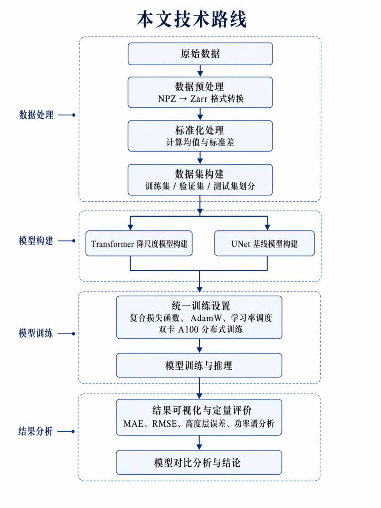

+++
date = '2026-06-01T00:00:00+08:00'
lastmod = '2026-10-23T00:00:00+08:00'
title = '面向风能应用的感知深度学习策略研究（上）：数据、模型与训练'
slug = 'undergraduate-thesis-wind-downscaling-data-models'
categories = ['科学机器学习']
tags = ['本科毕设', '风场降尺度', 'ViT', 'U-Net']
description = '本科毕业设计工作整理：基于 FuXi-CFD，完成大规模数据整理与公开、NPZ 到 Zarr 的预处理，以及 ViT 与二维 U-Net 的三维风场降尺度训练流程。'
math = true
+++

## 研究问题与工作范围

我的本科毕业设计题目是《面向风能应用的感知深度学习策略研究》，英文题目为 *Research on Perceptual Deep Learning Strategies for Wind Energy Applications*。研究围绕一个具体问题展开：**能否结合公里级水平风场和高分辨率地形信息，重建复杂地形上方的精细三维风场？**

这里的“感知”主要体现在模型对地形和下垫面信息的利用。山脊、谷地、坡面及地表粗糙度会改变局地气流；同一片区域即使背景风相近，不同位置的风速、垂直运动和湍流状态也可能不同。简单地把粗网格插值成细网格，只能增加网格点，无法直接补出这些地形相关结构。

本课题以 FuXi-CFD 的数据与方法为基础，围绕 Vision Transformer（ViT）和二维 U-Net 建立相同输入输出形式下的训练与评价流程。FuXi-CFD 原始研究由 Lin 等人完成；我的工作主要是数据整理与公开、流程实现、卷积基线构建，以及实验对比分析。原始数据集和方法的提出应归于原研究团队。[^fuxi]

> 本系列按毕设工作归档日期记为 2026 年 6 月 1 日，于 2026 年 10 月依据论文终稿、开题与中期材料、答辩幻灯片及遗留脚本回顾整理。部分终稿文件形成于 6 月上旬。本文保留已能核对的工作，不将早期计划视为已完成实验，也没有重新运行 HPC 训练。

为了避免一篇文章过长，内容分为两部分：本篇介绍数据、模型和训练；[下篇介绍实验结果、绘图脚本与研究复盘](/p/undergraduate-thesis-wind-downscaling-results/)。

## 从研究计划到完整实验流程

开题阶段确定了“地形感知的风场降尺度”方向，重点是利用 Transformer 建模空间关系，并与卷积网络比较。中期材料记录了输入输出梳理、PyTorch 基础模型搭建，以及从逐点误差训练向空间域与频域联合约束过渡的过程。后续终稿和答辩材料则补齐了二维 U-Net、统一训练流程与结果分析。

最终工作可以归纳为以下几部分。

| 工作环节 | 主要内容 | 留下的成果 |
| --- | --- | --- |
| 资料调研与任务定义 | 梳理复杂地形风场、CFD、降尺度、ViT 与 U-Net 的关系 | 开题报告、论文背景与方法章节 |
| 数据整理与公开 | 整理 FuXi-CFD 案例，分卷归档、上传并编写数据说明 | 约 253 GB 的公开数据与 dataset card |
| 数据预处理 | 统一变量、网格、张量顺序与标准化参数，采用 Zarr 供训练读取 | 论文流程说明与标准化笔记 |
| 模型与训练 | 实现 ViT 降尺度流程，加入二维 U-Net，使用统一损失和多卡训练 | 终稿、答辩中的模型与训练记录 |
| 推理与分析 | 生成预测场，分析收敛、误差、高度变化、空间结构和频谱 | 原始结果图、垂直廓线与散点图脚本 |



图中的流程贯穿了整个毕设：先明确数据含义和模型接口，再比较模型结构，最后从数值与空间结构两个角度评价结果。

## FuXi-CFD 数据整理与公开

### 数据来自哪里

FuXi-CFD 使用 CFD 模拟生成复杂地形上的高分辨率风场。根据毕设终稿，数据包含超过 12,000 个案例，每个案例对应约 $9\,\mathrm{km}\times9\,\mathrm{km}$ 的区域，水平网格为 $300\times300$，对应约 30 m 分辨率。[^fuxi]

训练目标是 CFD 参考场，因此模型学习的是给定粗风场与地形条件下的高分辨率重建关系。模型与 CFD 标签一致，并不自动代表它已经通过真实测风观测检验；本次毕设归档中没有独立实测验证结果。

### 我承担的数据工作

答辩材料记录，我负责了大规模数据的整理、分卷归档与 Hugging Face 上传，并编写数据集说明，明确案例结构、变量含义、数组形状和使用方式。公开数据总体量约为 253 GB，可从 [FuXi-CFD Dataset](https://huggingface.co/datasets/linchensen/FuXi-CFD-dataset) 访问。[^dataset]

这一部分工作的重点，是让大规模模拟结果能够被后续训练程序和其他使用者理解、读取，而不只是“把文件上传”。说明文档需要回答几个具体问题：一个案例包含哪些文件，输入与标签如何对应，变量的单位是什么，空间分辨率和垂直高度如何定义。

公开数据按案例组织，基本结构如下：

```text
case_000001/
├── inputs.npz
└── outputs.npz
```

公开仓库的字段名使用 `dem`、`roughness`、`u_100m` 和 `v_100m`。论文中有时简写为 $d$、$r$、$u_{100m}$ 和 $v_{100m}$；两者表达的是相同的物理量。实际读取时应以文件内的键名为准。

### 输入：地形与粗分辨率水平风场

| 变量 | 单个案例的形状 | 单位 | 含义 |
| --- | --- | --- | --- |
| `dem` / $d$ | $(300,300)$ | m | 数字高程模型，约 30 m 水平分辨率 |
| `roughness` / $r$ | $(300,300)$ | m | 气动粗糙度长度，约 30 m 水平分辨率 |
| `u_100m` | $(9,9)$ | m/s | 离地 100 m 的粗分辨率纬向风速分量 |
| `v_100m` | $(9,9)$ | m/s | 离地 100 m 的粗分辨率经向风速分量 |

两类信息的作用不同：粗分辨率风场提供背景风向与风速条件；地形和粗糙度提供地表约束。粗糙度长度具有长度单位，不能简单理解成没有单位的地表类别编号。

早期中期报告和部分结构图曾标注 10 m 输入，终稿的输入变量表与公开数据说明均使用 100 m。本系列按最终字段 `u_100m`、`v_100m` 说明任务，不把不同版本的高度设置混用。

### 输出：四个变量、二十七个高度层

| 变量 | 单个变量的形状 | 单位 | 含义 |
| --- | --- | --- | --- |
| $u$ | $(27,300,300)$ | m/s | 纬向风速分量 |
| $v$ | $(27,300,300)$ | m/s | 经向风速分量 |
| $w$ | $(27,300,300)$ | m/s | 垂直风速分量 |
| $k$ | $(27,300,300)$ | m²/s² | 湍流动能，Turbulent Kinetic Energy |

27 个高度层使用离地高度（AGL），并非海拔高度：

```text
5, 10, 15, 20, 25, 30, 35, 40, 45, 50,
55, 60, 65, 70, 75, 80, 85, 90, 95, 100,
106.5, 114.95, 125.94, 140.22, 158.78, 182.91, 214.29 m
```

这里的 $k$ 是 CFD 标签中的湍流统计量，不等于模型直接解析了瞬时湍流涡结构。重建四类变量，也不意味着已经完成风机功率或年发电量的预测。

## 数据预处理与统一接口

### 网格对齐和张量组织

预处理先将 $9\times9$ 的水平风速分量双线性插值到 $300\times300$，再与地形和粗糙度沿通道维拼接。按终稿约定，输入通道顺序为：

```text
[u_100m, v_100m, dem, roughness]
```

输入与输出的统一接口为：

$$
X\in\mathbb{R}^{B\times4\times300\times300},
\qquad
\widehat{Y}\in\mathbb{R}^{B\times27\times4\times300\times300}.
$$

其中 $B$ 是 batch size，输出变量维依次为 $u,v,w,k$。每个变量的原始数组是 $(27,300,300)$；组合四个变量时，需要沿明确的变量维堆叠，避免高度维与变量维交换。

双线性插值只负责尺寸对齐。真正学习地形与高分辨率风场关系的是后面的神经网络。

### 从 NPZ 到 Zarr

原始 NPZ 适合保存单个案例的多个数组，但训练需要频繁随机读取大量多维样本。毕设中将数据整理为 Zarr，并结合 Xarray 等工具读取，便于分块访问和统一管理。

处理链可以概括为：

```text
按案例读取 NPZ
→ 检查变量名、形状与有限数值
→ 对齐粗风场和地表网格
→ 按约定组织输入与标签
→ 写入 Zarr
→ DataLoader 分批读取
```

转换存储格式不会增加物理信息，也不会改变监督目标。它主要服务于训练阶段的数据访问；本次归档没有保留转换前后的 I/O 基准，因此不量化其加速倍数。

### 标准化与反标准化

输入包含高程、粗糙度和风速，输出还包含湍流动能，数值范围和单位差异较大。终稿采用均值与标准差标准化：

$$
x_{\mathrm{norm}}=\frac{x-\mu}{\sigma+\varepsilon},
\qquad
\widehat{x}=\widehat{x}_{\mathrm{norm}}(\sigma+\varepsilon)+\mu.
$$

这里第二式与第一式严格对应；实际程序若将 $\varepsilon$ 仅用于保护零标准差，反变换也应复用同一有效缩放量。终稿将反变换简写为乘标准差再加均值，整理时需要注意这一实现细节。

按终稿记录，输入分别统计四个通道，输出按变量与高度层统计；参数仅由训练集计算，并用于验证、测试及推理。遗留笔记列出了以下文件：

```text
constant/
├── height.npy
├── input_mean.npy
├── input_std.npy
├── output_mean.npy
└── output_std.npy
```

这些文件的名称和用途能够从笔记恢复，但对应的数组文件没有保存在本次毕设文件夹中。重新训练或推理时，还需要确认统计轴、广播形状和变量顺序；仅有文件名不足以恢复数值。

### 数据划分与评价边界

终稿采用约 $8:1:1$ 的训练、验证与测试划分，两种模型使用相同划分和统计参数。按案例 ID 划分可以避免同一案例重复出现，但**不等同于已经按地理区域隔离**：同一地形在不同风向条件下可能对应不同案例。

公开数据集本身没有预定义划分；毕设采用的划分也不应直接视为原论文的官方划分。归档中没有完整 ID 清单，因此不将按比例估算的样本数写成精确计数，也不据此声称完成了跨地形泛化验证。[^dataset]

## ViT 与二维 U-Net 的模型设计

### ViT：共享编码器与多分支输出

ViT 路线以 FuXi-CFD 的模型为基础。四通道输入首先经过特征嵌入与下采样，再进入由 **12 个 Transformer Block** 组成的共享编码器，最后通过四个输出分支分别重建 $u,v,w,k$。每个分支输出 27 个高度层。[^fuxi]

自注意力使不同位置的特征能够相互交换信息，适合探索上风向地形、山脊和谷地等较大范围结构与局地风场之间的关系。不过，注意力权重表示特征关联，不能仅凭结构图就证明网络学到了某一种具体流动物理机制。

归档中没有完整模型源文件与配置文件，无法逐项复核 patch size、embedding dimension、attention heads 和参数量，因此这里不补写未经确认的精确配置。

### 二维 U-Net：卷积基线与跳跃连接

在统一任务接口下，我加入二维 U-Net 作为卷积基线。其编码器逐层提取不同尺度的地形与风场特征，解码器恢复水平分辨率，跳跃连接将浅层细节传给对应的解码层，最后由输出头组织多高度、多变量结果。

这里“二维”描述的是主要卷积算子。模型输出虽然具有高度维，但并不因此变成三维 U-Net：高度信息通过输出通道表示，没有显式采用三维卷积处理整个体场。

终稿记录的编码尺度为：

```text
空间：300 → 150 → 75 → 37 → 18
通道：  4 →  64 → 128 → 256 → 512 → 1024
```

300 不是连续多次二分后都能精确对齐的尺寸。解码时需要检查上采样结果与跳跃连接的空间形状，并进行必要的尺寸对齐；最终输出必须恢复为 $300\times300$。对齐不仅要保证形状可拼接，还应避免引入网格位置偏移。

### 如何理解这组比较

| 比较项 | ViT | 二维 U-Net |
| --- | --- | --- |
| 主要特征操作 | 自注意力与前馈网络 | 二维卷积、下采样与上采样 |
| 信息交互方式 | 在 token 之间建立较大范围的关联 | 通过局部卷积与多尺度路径传播 |
| 输出 | 四个变量、27 层、$300\times300$ | 四个变量、27 层、$300\times300$ |
| 本课题中的作用 | 基于原方法实现的主要模型 | 在同一流程下加入的卷积基线 |

统一数据和训练流程，有助于减少比较中的干扰。但相同优化器和损失并不等于参数量、训练预算和调参程度完全匹配；这组实验用于比较当前设置下的结果，不构成注意力机制优于卷积机制的普遍结论。

## 联合损失与分布式训练

### 为什么同时关注点值和空间结构

训练采用 Charbonnier 损失与频域幅值损失。对标准化后的预测和标签，空间域部分可以写为：

$$
\mathcal{L}_{\mathrm{char}}
=\frac{1}{N}\sum_{i=1}^{N}
\sqrt{(\widehat{y}_i-y_i)^2+\varepsilon^2}.
$$

它是绝对误差的一种平滑近似，用于约束逐点预测偏差。频域部分则比较二维空间场傅里叶变换后的幅值。按终稿的文字含义，可概括为：

$$
\mathcal{L}_{\mathrm{freq}}
=\operatorname{mean}\left(
\left|\,|\mathcal{F}_{xy}(\widehat{Y})|
-|\mathcal{F}_{xy}(Y)|\,\right|
\right),
$$

$$
\mathcal{L}=\mathcal{L}_{\mathrm{char}}+\lambda\mathcal{L}_{\mathrm{freq}}.
$$

这里给出的是幅值损失的概念表达。FFT 归一化方式、频率加权、变量及高度的归约方式，以及 $\lambda$ 的具体取值，仍应以实际实现为准；本次归档没有保留完整 `loss.py`，不能仅靠论文公式还原这些配置。

联合损失的目的，是同时约束数值偏差和空间尺度分布。它没有直接施加质量守恒或动量方程约束，因此不应称为已经实现了 PINN。材料中也没有完整的“去除频域项”消融结果，不能把所有性能差异归因于频域损失。

### 训练环境与主流程

| 项目 | 归档记录 |
| --- | --- |
| 平台 | CFFF，Computing for the Future at Fudan |
| CPU 与内存 | 10 核 CPU、400 GB 内存 |
| GPU | 两张 A100 |
| Python / PyTorch | 3.8.20 / 1.13.1 |
| 优化器 | AdamW |
| 学习率调度 | warmup 与 StepLR |
| 并行方式 | PyTorch 分布式数据并行 |
| 日志与评价 | 收敛曲线、MAE、RMSE、变量与高度统计、空间图及功率谱 |

`packages.txt` 还记录了 NumPy 1.23.3、Matplotlib 3.6.0、Xarray 2023.1.0、Zarr 2.16.1 和 Dask 2023.5.0。这是一份当时的环境快照，不是已经重新验证的最小依赖清单。

训练主流程包括读取样本、标准化、前向预测、计算联合损失、反向传播、同步梯度、更新参数，以及每轮验证和保存结果。学习率先预热，再分阶段衰减；ViT 和 U-Net 使用相同的流程约定。

分布式数据并行让每张卡处理一部分样本，并同步梯度。它不会自动将单个样本或完整模型切到多张卡上，也不会简单合并两张卡的显存。验证阶段还需要正确汇总样本数与误差：例如应先汇总平方误差与元素数，再开方得到整体 RMSE，不能直接平均各卡 RMSE。

这些归约细节属于再次复现时需要核对的实现项。本次保留的文稿描述了多卡汇总过程，但缺少完整训练和验证源代码，不能把文稿说明当作已经重新审计过的实现。

## 推理输出与后续分析

推理时使用与训练相同的输入通道、网格和标准化参数，加载权重后进行一次前向计算，再将结果反标准化。单个样本的输出为：

$$
\widehat{Y}\in\mathbb{R}^{1\times27\times4\times300\times300},
\qquad
\widehat{u},\widehat{v},\widehat{w},\widehat{k}
\in\mathbb{R}^{27\times300\times300}.
$$

生成预测本身不需要 CFD 标签，但训练依赖 CFD 监督，评价也需要参考场。模型重建的是给定条件下的空间风场，并未在本课题中额外学习一个时间演化方程，不能直接将它等同于完整天气预报系统。

后续分析不只看总体误差，还检查各变量、各高度、空间重建和径向功率谱。具体结果，以及哪些结论仍受归档材料限制，见[下篇：实验结果与研究复盘](/p/undergraduate-thesis-wind-downscaling-results/)。

## 材料依据与参考资料

本篇主要依据毕设归档中的论文终稿、开题报告、中期报告、答辩幻灯片、标准化笔记及 `packages.txt` 整理。多份草稿和打印版用于交叉核对，重复内容不作为独立实验。归档未包含完整训练代码、模型权重、数据划分清单或原始日志，因此本文是工作记录整理，不是可直接运行的复现实验包。

[^fuxi]: Lin, C., Tie, R., Yi, S., et al. *Reconstructing fine-scale 3D wind fields with terrain-informed machine learning*. Nature Communications 17, 3713 (2026). [原论文](https://www.nature.com/articles/s41467-026-70562-5)，DOI: 10.1038/s41467-026-70562-5。本文借用其数据与方法背景，毕设实验结果在下篇单独说明。
[^dataset]: [linchensen/FuXi-CFD-dataset](https://huggingface.co/datasets/linchensen/FuXi-CFD-dataset)。变量定义与案例结构另据本地毕设终稿和答辩材料核对；公开页面于 2026 年 10 月整理时访问。
