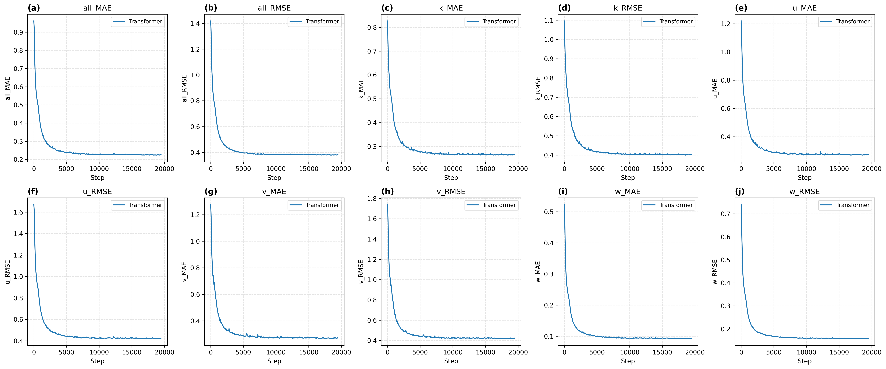
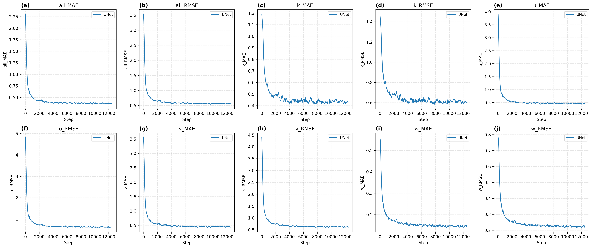
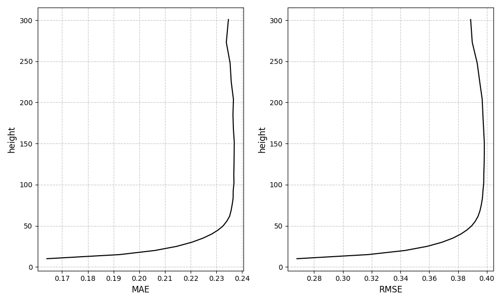
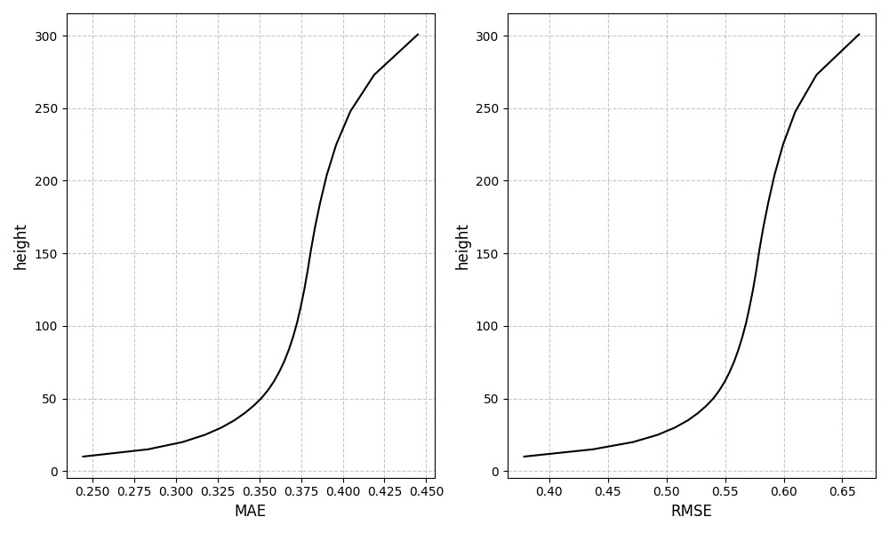
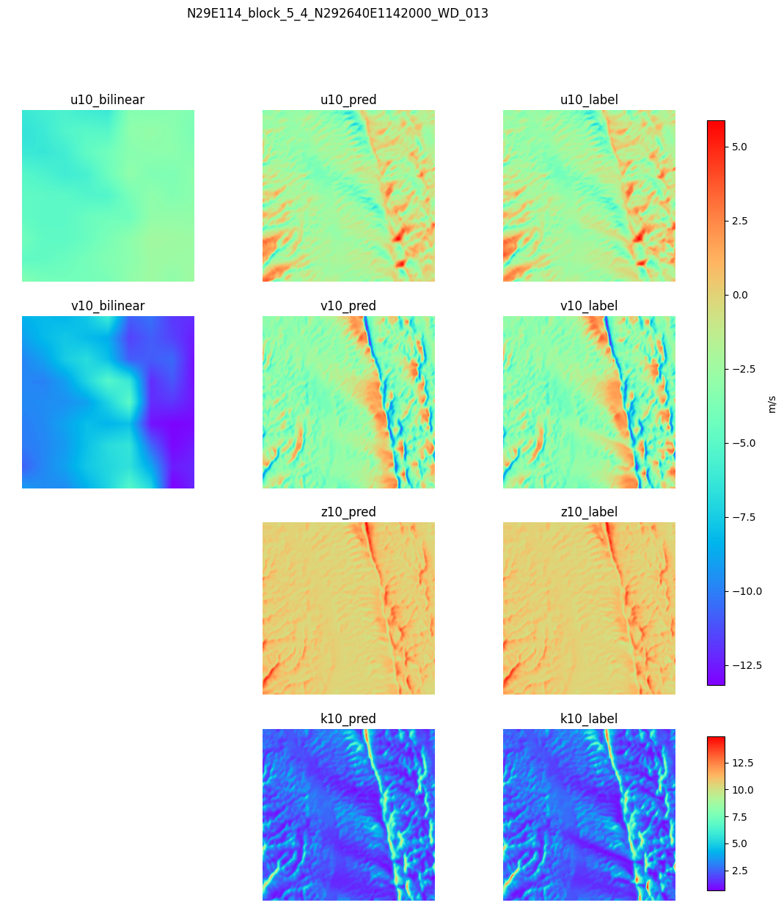
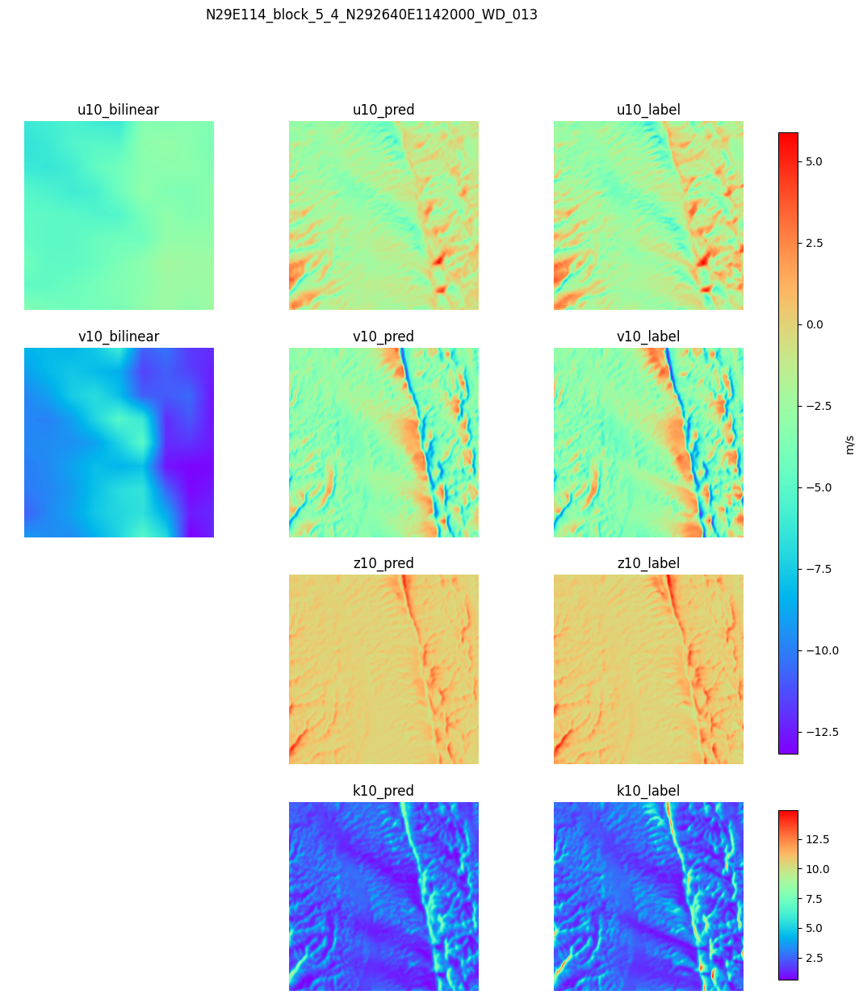
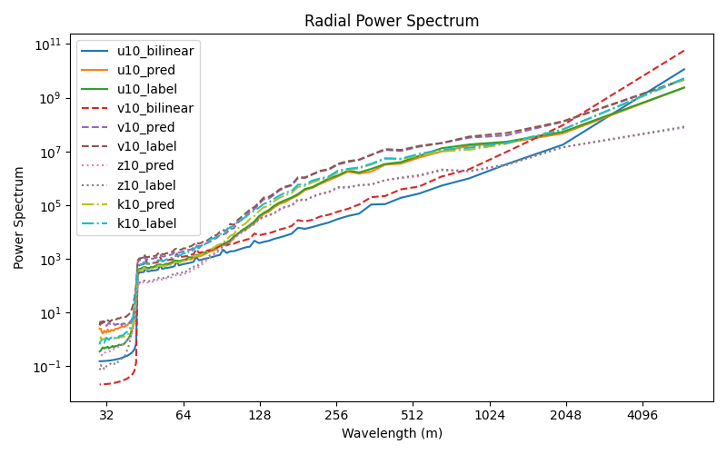
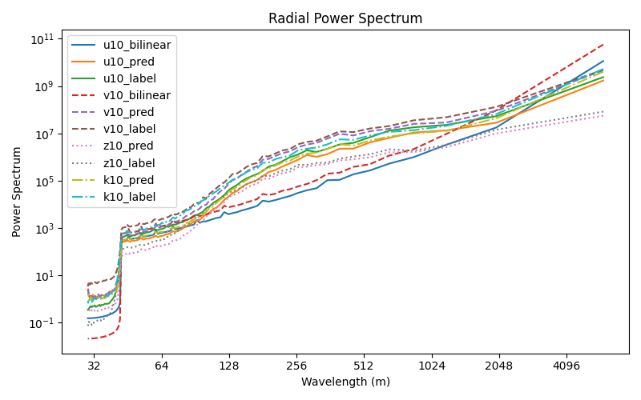

+++
date = '2026-06-01T00:00:00+08:00'
lastmod = '2026-10-23T00:00:00+08:00'
title = '面向风能应用的感知深度学习策略研究（下）：实验结果与研究复盘'
slug = 'undergraduate-thesis-wind-downscaling-results'
categories = ['科学机器学习']
tags = ['本科毕设', '风场降尺度', 'ViT', 'U-Net']
description = '本科毕设实验记录与复盘：比较 ViT 与二维 U-Net 的收敛、变量误差、高度误差、空间重建和径向功率谱，并梳理绘图脚本、证据边界及后续改进。'
math = true
+++

## 实验要回答什么

[上篇](/p/undergraduate-thesis-wind-downscaling-data-models/)介绍了数据整理、预处理、ViT 与二维 U-Net，以及统一训练流程。本篇整理本科毕业设计《面向风能应用的感知深度学习策略研究》的实验部分，重点回答：两类模型是否能学到降尺度映射，它们在哪些变量与空间结构上存在差异，以及现有记录能支持多强的结论。

> 本篇按毕设工作归档日期记为 2026 年 6 月 1 日，于 2026 年 10 月回顾整理。结果依据终稿、答辩材料和原始导出图，没有重新训练模型。文中的近似数值属于归档记录，不是此次重新计算的测试指标。

评价从几个互补角度展开：训练过程与验证误差反映优化情况，分变量和分高度统计定位误差来源，空间图检查地形相关纹理，功率谱检查不同空间尺度上的差异。计算资源与绘图脚本则帮助还原实验如何落地。

## 训练收敛与整体误差

### 两类模型是否完成了有效学习

两组曲线都在训练前期明显下降，随后进入相对稳定的区间，表明模型能够从输入条件中学习高分辨率参考场的部分结构。在这两次记录的训练中，ViT 后期总体误差较低；U-Net 的部分变量，尤其 $k$，波动更明显。

两张图的横轴都是 **Step，而不是 epoch**，终止步数也不同。因而不能仅凭横轴长度比较训练速度，也不能把图上的稳定区间直接解释为完全匹配训练预算后的结果。缺少完整训练集曲线，也不足以只靠验证曲线判断是否过拟合。

### 终稿与答辩中的近似读数

| 模型 | 整体 MAE，约 | 整体 RMSE，约 | 数值来源 |
| --- | ---: | ---: | --- |
| ViT | 0.23 | 0.38 | 终稿结果章节与答辩材料的验证曲线读数 |
| 二维 U-Net | 0.38 | 0.57 | 终稿结果章节与答辩材料的验证曲线读数 |

终稿摘要对 U-Net 写作约 0.37 / 0.56，正文与答辩写作约 0.38 / 0.57。这里保留后两者一致的口径，并把它们视为曲线近似读数，不当作精确到小数点后两位的独立测试集结果。

还需要区分“整体数值”与“具有同一物理单位的误差”。终稿说明在反标准化后评价，但总体汇总包含风速与湍流动能，两者单位不同，且当前没有原始指标代码可核对具体归约方式。因此表中不统一标注 m/s，也不据此换算百分比收益。它可以保留为当时的汇总记录；更严谨的重算应分别报告各变量误差和明确的无量纲总体指标。

当前实验支持的表述是：**在归档记录对应的设置下，ViT 的验证误差低于二维 U-Net。** 这尚不足以证明优势完全来自自注意力，也不能外推为所有地形或所有训练配置下的结论。

## 分变量与分高度的误差

### 四个物理变量需要分别看

$u,v$ 与粗分辨率水平风场直接对应，模型需要补充的是局地空间结构和垂直变化。$w,k$ 没有作为显式输入，需要结合地形和水平风场推断。

从归档曲线看，ViT 的 $u,v,k$ 后期误差整体较低，U-Net 的 $k$ 波动更明显。但 $w$ 的绝对误差本身较小，不能一概说“未作为输入的变量绝对误差一定更大”。变量的量级、单位和分布都会影响数值大小，尤其不能直接以 $k$ 的 MAE 和 $u$ 的 MAE 判断谁更难。

进一步分析时，应将同一变量在两种模型之间比较，再结合其典型幅值、相对误差和高值区域误差讨论。预测难度的物理解释可以作为假设，仍需要分组统计或消融实验支持。

### 高度误差图保留了什么信息

毕设终稿据这两张图描述：图中误差随高度增加而升高，ViT 曲线的误差范围总体较低。原图也确实保留了这种绘图趋势，但本次整理发现了一处必须说明的不一致：**两图纵轴延伸至约 300 m，最终输入输出说明中的 27 层最高为 214.29 m。**

缺少原始数组和绘图配置，无法确认这是旧版本高度表、坐标映射错误，还是不同实验设置。因此本篇保留原图用于记录已有分析工作，不将其作为最终 27 层在精确高度上的误差证明，也不补写“300 m 验证结果”。

终稿将误差增长解释为垂直结构推断更加困难，但这一解释尚需在高度坐标和评价口径一致后验证。近地层本身可能存在更强的地形扰动，绝对误差趋势也受变量幅值影响；不能把“越高越难”当作普遍规律。

重新分析时，首先应让误差数组与实际 `height.npy` 一一对应，再分别绘制 $u,v,w,k$ 的 MAE、RMSE 和相对误差。这样才能判断究竟是哪一个变量、哪一段高度产生了主要偏差。

## 空间风场重建

### 如何阅读对比图

两图按变量排列，左侧是水平风速的双线性插值，中间为预测，右侧为 CFD 参考场。$w$ 和 $k$ 不属于粗风场输入，因此对应位置没有可直接插值的输入图。

从这些示例可以看到，双线性插值结果较平滑，而模型预测出现了更多与 CFD 参考场相似的空间纹理，包括细长结构、局地梯度和不均匀分布。这说明模型输出并非只是在原有粗网格上做平滑过渡。

不过，这里是代表样本的视觉检查，不是全测试集统计。两种模型的图中有不少相似细节，仅凭一组示例难以可靠量化谁的局部结构更好。若要评价强梯度或高湍流区域，应固定案例、变量、高度、色阶，并增加差值图和区域误差统计。

### 统一变量名、单位和高度标签

原图将垂直风速写为 `z10`，绘图脚本中也出现将原始通道 `z` 重命名为 `w` 的处理。本文正文统一使用 $w$ 表示垂直风速，避免与高度坐标 $z$ 混淆。

原图中的 `u10`、`v10` 等名称应视为归档中的原始标签，不能据此改变上篇定义的 100 m 输入条件，也不能仅凭后缀确认该图的真实输出层。图中风速色标使用 m/s；$k$ 应使用 m²/s²，阅读时需要分别识别。

这些原图按原貌保留，没有根据推测重新标注高度。若要形成可复算的正式结果图，还需要将案例 ID、输出层索引、实际 AGL 高度及模型 checkpoint 一并记录。

## 径向功率谱与空间尺度

### 为什么误差之外还要看频谱

逐点误差较小的预测仍可能过度平滑。为检查不同空间尺度上的差异，毕设对二维场进行傅里叶变换，并分析径向平均的功率谱。基本关系为：

$$
F(k_x,k_y)=\mathcal{F}_{xy}[Y(x,y)],
\qquad
P(k_x,k_y)=|F(k_x,k_y)|^2.
$$

将二维频率按径向分组后，可对照预测、CFD 参考和双线性插值在不同波长上的谱分布。波长较短对应更细的空间变化；谱曲线偏低可能反映该尺度上的波动幅度不足。

归档图中，预测曲线在部分波长区间比水平风速插值更接近参考场，表明网络恢复了一部分粗网格中缺失的空间尺度特征。不同变量和波长上的偏差并不相同，评价时需要逐条对应图例。

### 频谱可以说明什么

这组分析补充了空间图与点值误差：它能检查不同尺度的波动幅度，却不能单独证明预测位置正确。幅值谱不包含完整相位信息，两个空间分布不同的场也可能具有相近的功率谱。

同样，这里是各输出变量的二维空间功率谱。图中的“功率”不等于风机发电功率，曲线接近也不代表已经验证了湍流能量级联、质量守恒或动量守恒。原图将多个变量叠在一起，各变量单位不同，适合比较同一变量的预测与参考，不宜比较变量之间的纵轴大小。

频域损失是本次训练的组成部分，但两种模型都采用了它。没有完整的有无该损失的对照实验，就不能仅凭这些图量化它带来的独立收益。

## 绘图脚本与实验工程记录

### 垂直廓线脚本

遗留的 `profile.txt` 实际保存了一段 Python 后处理代码：从预测 Zarr 中选择一个案例，读取对应 CFD 标签和 DEM，在三个水平位置提取 $u,v,w,k$ 随高度的变化，并保存用于绘图的数组。

脚本固定 `random.seed(46)` 来选择一个案例，三个采样位置则是手工给定的索引。其目的，是把二维切片检查扩展为点位垂直剖面检查，观察风速分量和湍流动能随高度的变化是否接近参考场。

这段代码还保留了几项重要的版本线索：

| 线索 | 对再次使用脚本的影响 |
| --- | --- |
| 高度数组取 `[2:20]`，共 18 层 | 与最终 27 层任务不同，应独立核对，不能直接拼入终稿结果 |
| 预测使用 `level=slice(0,17)` | Xarray 标签切片通常包含端点，需确认真实 level 坐标 |
| 原始标签裁去水平边缘 `[10:-10]` | 要确认预测和标签是否落在同一块有效区域 |
| 通道 `z` 重命名为 `w` | 需要保持物理变量与数组通道一致 |
| 索引使用 `300 - item` 变换 | 需结合轴方向和坐标定义检查，不能只按图像直觉翻转 |

归档未包含脚本引用的 Zarr、`height.npy` 或其导出的 NPY 数组，因此此次只梳理代码意图，没有声称重新生成了垂直廓线结果。

### Parity plot：预测与参考的一致性检查

`pariyplot.txt` 是另一段 Python 绘图片段，设计为两行四列，分别对照标注为 AGL 10 m 和 100 m 的四个变量。横纵轴使用相同范围，并绘制 $y=x$ 参考线，通过散点偏离程度观察系统偏差与离散程度。

点的颜色来自 `gaussian_kde` 估计的散点密度，**不是预测误差**。脚本采用展平后按固定步长抽取点，而非真正的随机抽样；这可能影响哪些空间位置被保留。所有面板统一密度色标也有助于避免每张图独立缩放造成的视觉误读。

当前片段依赖外部 `labeldata` 和 `preddata`，没有独立的数据加载入口，归档中也没有对应成图。它说明当时准备了这一诊断工具，但不能据此补出相关系数、$R^2$ 或新的定量结论。

### 训练成本与复现材料

终稿记载，在两张 A100 上，U-Net 的训练速度约为每天 100 个 epoch，并估计 1,000 个 epoch 约需 10 天。这是当时的经验记录；归档缺少对应作业日志、batch size 和完整运行配置，不将它作为可重复的性能基准。

模型训练后通过前向计算生成结果，避免了为每次预测重新求解完整 CFD 的流程。但本次毕设材料没有成对记录同硬件、同条件下的端到端耗时，因此不写具体推理加速倍数，也不将原 FuXi-CFD 论文的测速或实测验证移作本人的实验结果。[^paper]

当前资料足以恢复研究思路、任务接口和主要图表，但还不足以独立重建整次训练。再次复现应补齐数据划分、标准化参数、训练配置、代码版本、checkpoint、原始指标和图表生成脚本，并将它们关联到同一个实验编号。

## 已完成工作与后续方向

### 哪些内容已经形成成果

| 方向 | 本次能够确认的状态 |
| --- | --- |
| 数据整理与公开 | 答辩记录了约 253 GB 的分卷整理、上传与数据说明编写，公开仓库可访问 |
| ViT 降尺度流程 | 终稿与答辩记录了模型实现、训练、推理及可视化 |
| 二维 U-Net 基线 | 保留了结构说明、验证曲线与多类结果图 |
| Charbonnier 与频域联合损失 | 是终稿明确采用的训练方案 |
| 多角度评价 | 已记录收敛、整体及变量误差、高度分析、空间图、频谱与资源讨论 |
| 廓线与散点诊断 | 保留了脚本片段；当前无法重算完整结果 |

早期笔记还提出过 Charbonnier、加入 FFT、再加入高值区域 Top10 误差的消融方案，以及通过 `VanillaTransformerPlus` 增加三维卷积后处理的探索。中期报告也讨论过散度约束和分层解码。这些线索值得保留，但没有完整的配置、训练日志和成套对照结果，不能列为已经证实有效的最终改进。

### 如果继续做这项研究

首先需要统一现有实验记录：核对 100 m 输入、真实高度表、变量通道、误差单位和聚合方式，恢复能从数组追溯到图表的流程。这个步骤先于扩充更多模型。

然后可以从四个方向继续：

- **泛化检验**：按地形或地理块划分训练与测试，检查同一地形的不同来流案例是否跨集合，并加入不同风速、风向的分组结果。
- **垂直结构建模**：尝试垂直注意力、三维卷积或高度序列建模，重点观察 $w,k$ 和跨层连续性；这些属于后续实验方向。
- **物理约束与消融**：分别验证 DEM、粗糙度、频域项和高值区域损失的作用；质量守恒约束需要结合实际地形坐标与网格度量实现。
- **真实观测与部署**：用测风塔或激光雷达数据独立检验，再评估批量推理、混合精度或 ONNX 部署。FNO、PINN 及混合结构也可以作为新的对照路线，而非本次已经完成的模型。

毕设最主要的收获，是把数据理解、存储组织、模型训练和结果解释连成了一个完整过程。当前记录显示，ViT 在这组实验中取得了较低的验证误差，二维 U-Net 也能够恢复部分高分辨率结构；与此同时，结果是否可信，还取决于高度、单位、数据划分和图表来源是否保持一致。

## 材料依据与参考资料

本篇依据归档论文终稿第 4—6 章、答辩幻灯片、`毕设` 目录下的八张结果图、`profile.txt`、`pariyplot.txt` 和标准化笔记整理。结果图片使用原始导出文件，保留原始标签；涉及版本差异的地方已在正文注明。旧稿与打印版用于核对，不重复计算为额外成果。

原始数据与方法可参阅 [FuXi-CFD Dataset](https://huggingface.co/datasets/linchensen/FuXi-CFD-dataset)。研究背景、数据与模型设计见[本系列上篇](/p/undergraduate-thesis-wind-downscaling-data-models/)。

[^paper]: Lin, C., Tie, R., Yi, S., et al. *Reconstructing fine-scale 3D wind fields with terrain-informed machine learning*. Nature Communications 17, 3713 (2026). [原论文](https://www.nature.com/articles/s41467-026-70562-5)，DOI: 10.1038/s41467-026-70562-5。原研究的独立测风塔检验与性能结论，应与本篇毕设记录区分。
